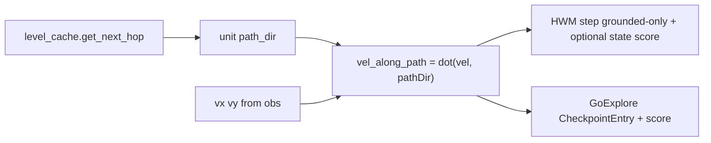

# Addendum: Grounded HWM, state-aware scoring, and Go-Explore metadata

This extends [Section 7–8](nclone/.cursor/plans/value_function_audit_5942eae0.plan.md) of the Value Function Audit plan. **Do not remove** the existing HWM + Go-Explore narrative; append this as **Section 9** (and extend Stage 3 in Section 8 with the bullets below).

---

## 9.1 Grounded-only watermark updates

**Idea:** Only allow the HWM to improve (and only call `EpisodeRewardState.step` for distance improvement) when the ninja has stable contact: `floor_count > 0` or `walled` (same notion as “not airborne” for movement policy).

**Rationale:** Reduces credit for transient geometric “progress” mid-air over chasms; watermark reflects **landable / actionable** progress. Pairs with vision + LSTM (delayed reward until landing).

**Implementation touchpoints:**

- `[main_reward_calculator.py](nclone/nclone/gym_environment/reward_calculation/main_reward_calculator.py)`: before `hwm_state.step(...)`, derive `is_grounded` from `obs` (or simulator); if not grounded, pass **no** distance improvement (either skip `step` with last distances, or add a `grounded: bool` parameter to `[hwm_shaping.py](nclone/nclone/gym_environment/reward_calculation/hwm_shaping.py)` `EpisodeRewardState.step`).

**Consistency:** Gate `**BACKTRACK_PENALTY`** in the same block (lines ~244–252) when not grounded, so “backtrack” is not judged during jump arcs.

---

## 9.2 State-aware HWM (distance + velocity + jump)

**Idea:** Beyond scalar distance, treat “better state” as: same or better path distance **and** better continuation quality — e.g. speed **along the planned path**, and optionally **jump hold remaining** when in jump state.

**Options (pick one in implementation):**

- **A (minimal):** Distance-only HWM when grounded; separate **small bonus** when grounded and distance unchanged but `vel_along_path` improved (preserves clear distance budget semantics).
- **B (composite watermark):** Single score per phase, e.g. `S = -dist + w_v * vel_along_path + w_j * jump_remaining_term`, with `vel_along_path` in `[-MAX_HOR_SPEED, MAX_HOR_SPEED]` normalized; fire shaping when `S` exceeds prior best. **Revisit normalization / bound** on total shaping (current doc claims total HWM ≤ 1 per phase for distance-only).

**Velocity alignment — use graph path direction, not bearing to goal:**

- Use **next hop** from the level cache: unit vector from current **ninja grid node** to `level_cache.get_next_hop(node, goal_id)` in world space (same construction as `[feature_computation.py](nclone/nclone/graph/reachability/feature_computation.py)` lines 573–589).
- `vel_along_path = vx * dir_x + vy * dir_y` (optionally clamp / normalize by `MAX_HOR_SPEED`).

**Smoothing (optional):** Next-hop can flip every 6px; for stabler alignment, direction to a node **K hops** ahead along `[_reconstruct_path_from_next_hop](nclone/nclone/graph/reachability/path_distance_calculator.py)` (e.g. K=4–5), then normalize.

**Plumbing:** `[path_distance_calculator.py](nclone/nclone/graph/reachability/path_distance_calculator.py)` already computes a `path_dir` for cache hits (~814–827); expose `**(distance, path_dir)`** (or add `get_next_hop_direction(...)`) for the reward calculator so HWM does not duplicate cache logic.

**Jump term:** `jump_duration` / remaining hold is only meaningful in jump state (see ninja `think()` / `game_state` layout in `[base_environment.py](nclone/nclone/gym_environment/base_environment.py)`); weight small or apply only when `state == 3`.

---

## 9.3 Go-Explore archive: store and score with same state

**Idea:** Checkpoints should prefer “better arrivals” at similar cells: not just position/distance.

`**[CheckpointEntry](npp-rl/npp_rl/exploration/checkpoint_archive.py)`** already has `ninja_velocity`. **Add** fields such as:

- `jump_duration_remaining` (or raw index consistent with env)
- `ninja_state_code` (sim state 0–5) and/or explicit `floor_count` / `walled` flags if needed for analysis

**Scoring:** Extend `[_calculate_trajectory_score](npp-rl/npp_rl/exploration/checkpoint_archive.py)` (or the path that compares two entries for the same cell) to use:

- primary: distance / cumulative reward (existing),
- tiebreak: `vel_along_path` using **same next-hop direction** as HWM,
- secondary tiebreak: jump remaining (small weight).

Ensure **replay determinism** unchanged: extra fields are for **selection and logging**, not substituting for action replay unless you intentionally add full state snapshots.

---

## 9.4 Diagram (data flow)

---

## 9.5 Extend Section 8 Stage 3 (Go-Explore / HWM)

Add to **Stage 3** (and optionally Stage 1 if path_dir is exposed early):

1. Expose next-hop (or K-hop) **path direction** from path distance / level cache API.
2. Implement **grounded-only** HWM + gated backtrack penalty.
3. Implement **state-aware** HWM (option A or B above) with documented constants `w_v`, `w_j`.
4. Extend **CheckpointEntry** and Go-Explore comparison logic with velocity alignment + jump metadata.

