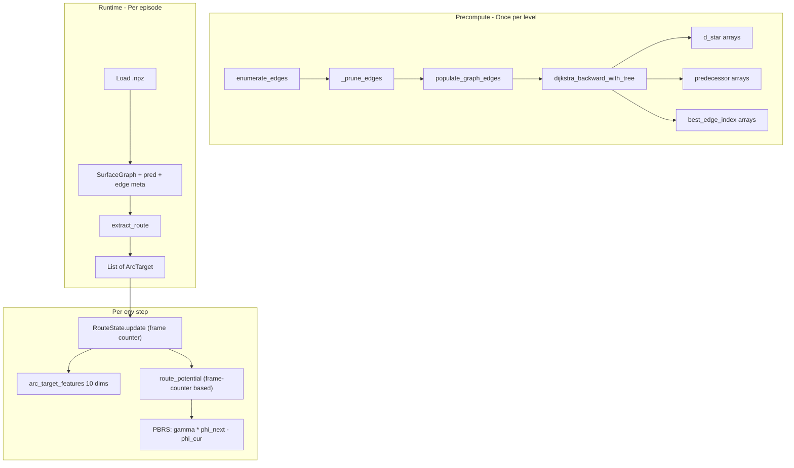

# Route Graph + Arc Targets Implementation

## Current State (What Exists)

The **surface graph** pipeline (`nclone/value_function/`) already provides most of the routing infrastructure:

- `extract_surfaces` samples floor/wall segments at 6px resolution
- Nodes are `(surface_point, velocity_bin)` pairs (~45K nodes)
- `enumerate_edges` discovers transitions via physics simulation, storing `EdgeResult(src_node, dst_node, weight)` and `ArcWaypoint` frame-by-frame samples
- `dijkstra_backward` computes `d_star[node]` cost-to-go arrays for switch and exit goals
- `_prune_edges` keeps one edge per `(src, dst)` pair (minimum weight)
- Everything is saved to a compressed `.npz` file

**Key gaps** in the existing infrastructure:

1. `dijkstra_backward` returns only `d_star` -- no predecessor array, so the shortest-path tree cannot be traced
2. `EdgeResult` has no action metadata (jump hold duration, horizontal input) -- these are discarded after simulation
3. No route extraction or tracking logic exists
4. The `.npz` format has no predecessor or edge-action-parameter arrays

At runtime, `SurfaceGraphPBRS.get_potential(state)` does nearest-node lookup + arc cache interpolation for a scalar potential. The `PrimitiveRewardCalculator` computes PBRS as `phi_next - phi_prev`. Observations include 10 reachability dims (8 from A* path features + 2 phi-gradient).

## Architecture Changes




## Key Design Decisions

### Frame-counter potential, not distance-based

Mid-jump, Euclidean distance to landing is non-monotonic (at apex the agent is closer to landing than a few frames later when the arc curves away). This creates spurious negative PBRS at correct execution moments. Instead, track arc progress by frame count:

```python
frames_remaining_this_arc = max(0, arc.arc_cost_frames - frames_into_current_arc)
total_remaining = frames_remaining_this_arc + arc.cumulative_cost
phi = -total_remaining / route[0].cumulative_cost
```

This is monotonically non-decreasing along the planned arc. If the agent takes longer than expected, `frames_remaining` clamps at 0 -- potential stalls rather than penalizing.

### Observation stays at 10 dims

`vy_proxy` is a rescaling of `dy_land` (redundant). `surface_normal` is already in game state features (floor_normal_x at index 22, surface contact at 14-16). Dropping both keeps `REACHABILITY_FEATURES_DIM = 10`, meaning zero changes to the feature extractor architecture.

### Arc cache not used by RoutePBRS

Frame-counter potential doesn't need spatial (x,y,vx,vy) -> cost lookups for airborne states. The arc cache was necessary when `get_potential` mapped arbitrary positions to cost-to-go. With route tracking, potential is purely frame-counter-based. Arc cache arrays are still saved in `.npz` for backward compat with `SurfaceGraphPBRS` but `RoutePBRS` does not load or use them.

### `h_input_during` is primary air control only

Edge enumeration uses two-phase air control (h_during + h_after_release). Only `h_input_during` is stored per edge. The agent learns post-release air control reactively from spatial context (tile grid shows obstacles mid-arc). The arc's landing point is in the observation; the agent just needs to reach it. This is a deliberate simplification -- the execution policy should be reactive, not blindly following a precomputed input sequence.

## Implementation Steps

### 1. Extend edge enumeration to store action metadata

**File:** [nclone/value_function/edge_enumeration.py](nclone/value_function/edge_enumeration.py)

Add `jump_hold_frames` and `h_input_during` to `EdgeResult`:

```python
@dataclass
class EdgeResult:
    src_node: int
    dst_node: int
    weight: float
    jump_hold_frames: int = 0
    h_input_during: int = 0  # primary horizontal input only; post-release learned from spatial context
```

Update `_try_edge` closures in `_enumerate_node_edges` to pass these through. For floor runs: `jump_hold_frames=0, h_input_during=h_input`. For floor jumps: `jump_hold_frames=hold_dur, h_input_during=h_during`. For wall jumps: `jump_hold_frames=hold_dur, h_input_during=h_input`. `_prune_edges` already keeps the full `EdgeResult` object for the minimum-weight edge, so metadata is preserved automatically. Store two new parallel arrays in `populate_graph_edges`:

```python
graph.edges_jump_hold = np.array([e.jump_hold_frames for e in edges], dtype=np.int8)
graph.edges_h_input = np.array([e.h_input_during for e in edges], dtype=np.int8)
```

### 2. Extend Dijkstra to return shortest-path tree

**File:** [nclone/value_function/surface_graph.py](nclone/value_function/surface_graph.py)

Add a new function `dijkstra_backward_with_tree` (keep the old one for backward compat):

```python
def dijkstra_backward_with_tree(graph, goal_nodes, blocked_nodes=None):
    """Like dijkstra_backward but also returns predecessor and best-edge-index arrays.
    
    Predecessor convention (backward Dijkstra):
        predecessor[v] = u means: from node v, the optimal next step toward
        the goal is to traverse the original edge v -> u. Equivalently,
        d_star[u] + w(v->u) == d_star[v] for the best edge.
        
        Invariant: d_star[predecessor[v]] < d_star[v] for all non-goal v
        with finite d_star. Goal nodes have predecessor[v] = -1.
    """
    # Build reversed adjacency WITH edge indices for lookup
    # rev_adj[dst] -> list of (src, weight, original_edge_index)
    # When relaxing v via reversed edge (u <- v):
    #   predecessor[v] = u  (u is closer to goal)
    #   best_edge_idx[v] = original_edge_index of the v->u edge
    return d_star, predecessor, best_edge_idx
```

The reversed adjacency must track original edge indices so `best_edge_idx[v]` points into `graph.edges_src/dst/weight/jump_hold/h_input` arrays.

Add `edges_jump_hold`, `edges_h_input` optional fields to the `SurfaceGraph` dataclass (default `None`).

### 3. Create route extraction module

**New file:** [nclone/value_function/route_extraction.py](nclone/value_function/route_extraction.py) (~200 lines)

```python
@dataclass
class ArcTarget:
    launch_segment_id: int
    launch_x: float
    launch_y: float
    launch_vx: float
    surface_normal_x: float
    surface_normal_y: float
    jump_hold_frames: int
    h_input_during: int
    landing_x: float
    landing_y: float
    landing_vx: float
    arc_cost_frames: float   # expected frame count (for frame-counter clamp)
    cumulative_cost: float   # d_star of destination node

def extract_route(graph, d_star, predecessor, best_edge_idx, start_node) -> list[ArcTarget]:
    """Trace the Dijkstra shortest-path tree from start_node to any goal.
    
    Returns empty list if start_node has infinite d_star (unreachable).
    """
    if not np.isfinite(d_star[start_node]):
        return []
    route = []
    node = start_node
    while predecessor[node] != -1:
        next_node = predecessor[node]
        edge_i = best_edge_idx[node]
        # Decompose node IDs to surface point + velocity bin
        # Build ArcTarget from graph.surface_points[src_pt] + graph.surface_points[dst_pt]
        #   + graph.edges_jump_hold[edge_i] + graph.edges_h_input[edge_i]
        #   + graph.edges_weight[edge_i] (arc_cost_frames)
        #   + d_star[next_node] (cumulative_cost)
        route.append(ArcTarget(...))
        node = next_node
    return route

def find_nearest_start_node(graph, x, y, vx, vy, contact_state, d_star) -> Optional[int]:
    """Map continuous agent state to nearest graph node for route extraction.
    
    If agent is on a surface: use find_nearest_node with position + velocity.
    If agent is airborne: predict landing point using ballistic trajectory
    (constant vx, vy += GRAVITY_FALL per frame until hitting a surface point
    below), then find nearest node at predicted landing. Falls back to
    nearest surface point below if prediction fails.
    
    Returns None if no reachable node found (d_star = inf for all candidates).
    """
```

### 4. Create route-based PBRS adapter

**New file:** [nclone/value_function/route_pbrs.py](nclone/value_function/route_pbrs.py) (~300 lines)

This replaces `SurfaceGraphPBRS` with the same `get_potential(state_dict)` interface so `PrimitiveRewardCalculator` needs minimal changes.

```python
@dataclass
class RouteState:
    arc_idx: int = 0
    frames_into_current_arc: int = 0
    replan_count: int = 0
    on_route_frames: int = 0
    total_frames: int = 0

class RoutePBRS:
    """Route-tracking PBRS that replaces SurfaceGraphPBRS.
    
    Uses frame-counter-based potential for monotonic shaping during arcs.
    Replans on surface landing when agent deviates from planned route.
    Falls back to raw d_star potential when route is empty (unreachable start).
    """
    
    def __init__(self, graph, d_star_switch, d_star_exit, 
                 pred_switch, pred_exit, best_edge_switch, best_edge_exit,
                 d_max_switch, d_max_exit):
        self._graph = graph
        # ... store all arrays ...
        self._route: list[ArcTarget] = []
        self._state = RouteState()
        self._phase = 0  # 0=switch, 1=exit
        self._total_route_cost = 1.0  # normalization denominator
    
    def reset(self, start_x, start_y, start_vx, start_vy, contact_state):
        """Called on episode reset. Extract initial route."""
        d_star = self._d_star_switch  # always start in phase 0
        pred = self._pred_switch
        best_edge = self._best_edge_switch
        start_node = find_nearest_start_node(
            self._graph, start_x, start_y, start_vx, start_vy,
            contact_state, d_star)
        if start_node is not None:
            self._route = extract_route(
                self._graph, d_star, pred, best_edge, start_node)
        else:
            self._route = []
        self._state = RouteState()
        self._phase = 0
        self._total_route_cost = (
            self._route[0].cumulative_cost if self._route 
            else self._d_max_switch
        )
    
    def update(self, state_dict):
        """Called each physics frame. Advance arc, replan, or handle phase transition."""
        self._state.total_frames += 1
        
        # Phase transition: switch collected mid-episode
        if state_dict.get('switch_activated', False) and self._phase == 0:
            self._handle_phase_transition(state_dict)
            return
        
        if not self._route:
            return
        
        self._state.frames_into_current_arc += 1
        
        # Arc advancement: agent landed on surface near next arc's launch point
        if state_dict.get('on_surface', False) and self._state.arc_idx < len(self._route) - 1:
            next_arc = self._route[self._state.arc_idx + 1]
            if _near(state_dict, next_arc.launch_x, next_arc.launch_y, threshold=12.0):
                self._state.arc_idx += 1
                self._state.frames_into_current_arc = 0
                self._state.on_route_frames += 1
                return
        
        # Replanning: agent on surface but far from expected position
        if state_dict.get('on_surface', False):
            arc = self._route[self._state.arc_idx]
            if not _near(state_dict, arc.launch_x, arc.launch_y, threshold=36.0):
                self._replan_from_current(state_dict)
    
    def _handle_phase_transition(self, state_dict):
        """Full replan on switch collection. Handles airborne-at-switch case."""
        self._phase = 1
        if state_dict.get('on_surface', False):
            start = find_nearest_start_node(
                self._graph, state_dict['x'], state_dict['y'],
                state_dict['vx'], state_dict['vy'],
                state_dict.get('contact_state'), self._d_star_exit)
        else:
            # Airborne at switch collection: predict landing point
            landing = _predict_ballistic_landing(
                state_dict['x'], state_dict['y'],
                state_dict['vx'], state_dict['vy'],
                self._graph)
            if landing is not None:
                start = find_nearest_start_node(
                    self._graph, landing[0], landing[1], landing[2], 0.0,
                    'floor', self._d_star_exit)
            else:
                start = find_nearest_start_node(
                    self._graph, state_dict['x'], state_dict['y'],
                    state_dict['vx'], state_dict['vy'],
                    state_dict.get('contact_state'), self._d_star_exit)
        
        if start is not None:
            self._route = extract_route(
                self._graph, self._d_star_exit, self._pred_exit,
                self._best_edge_exit, start)
        else:
            self._route = []
        self._state.arc_idx = 0
        self._state.frames_into_current_arc = 0
        self._state.replan_count += 1
        self._total_route_cost = (
            self._route[0].cumulative_cost if self._route
            else self._d_max_exit
        )
    
    def _replan_from_current(self, state_dict):
        """Replan from agent's current surface position."""
        d_star = self._d_star_exit if self._phase == 1 else self._d_star_switch
        pred = self._pred_exit if self._phase == 1 else self._pred_switch
        best_edge = self._best_edge_exit if self._phase == 1 else self._best_edge_switch
        start = find_nearest_start_node(
            self._graph, state_dict['x'], state_dict['y'],
            state_dict['vx'], state_dict['vy'],
            state_dict.get('contact_state'), d_star)
        if start is not None:
            self._route = extract_route(self._graph, d_star, pred, best_edge, start)
        else:
            self._route = []
        self._state.arc_idx = 0
        self._state.frames_into_current_arc = 0
        self._state.replan_count += 1
        d_max = self._d_max_exit if self._phase == 1 else self._d_max_switch
        self._total_route_cost = (
            self._route[0].cumulative_cost if self._route else d_max
        )
    
    def get_potential(self, state_dict) -> float:
        """Frame-counter-based PBRS potential, normalized to [-1, C_PHASE]."""
        if not self._route:
            # Fallback: raw d_star potential (same as SurfaceGraphPBRS)
            d_star = self._d_star_exit if self._phase == 1 else self._d_star_switch
            d_max = self._d_max_exit if self._phase == 1 else self._d_max_switch
            node = find_nearest_start_node(
                self._graph, state_dict['x'], state_dict['y'],
                state_dict['vx'], state_dict['vy'],
                state_dict.get('contact_state'), d_star)
            if node is not None and np.isfinite(d_star[node]):
                phi = -d_star[node] / d_max
            else:
                phi = -1.0
            if self._phase == 1:
                phi += C_PHASE
            return phi
        
        arc = self._route[self._state.arc_idx]
        frames_remaining = max(0, arc.arc_cost_frames - self._state.frames_into_current_arc)
        total_remaining = frames_remaining + arc.cumulative_cost
        phi = -total_remaining / self._total_route_cost
        if self._phase == 1:
            phi += C_PHASE
        return phi
    
    def get_arc_target_features(self, state_dict) -> np.ndarray:
        """Compute 10-dim arc target observation features.
        
        Returns zeros if route is empty (fallback mode).
        """
        if not self._route:
            return np.zeros(10, dtype=np.float32)
        
        arc = self._route[self._state.arc_idx]
        x, y = state_dict['x'], state_dict['y']
        vx = state_dict['vx']
        
        TILE_PX = 24.0
        dx_launch = (arc.launch_x - x) / (TILE_PX * 4)
        dy_launch = (arc.launch_y - y) / (TILE_PX * 4)
        vx_error = (arc.launch_vx - vx) / MAX_HOR_SPEED
        dx_land = (arc.landing_x - x) / (TILE_PX * 8)
        dy_land = (arc.landing_y - y) / (TILE_PX * 8)
        jump_hold_norm = arc.jump_hold_frames / MAX_JUMP_DURATION
        required_speed = abs(arc.launch_vx) / MAX_HOR_SPEED
        progress = 1.0 - (arc.cumulative_cost / self._total_route_cost) if self._total_route_cost > 0 else 0.0
        switch_activated = 1.0 if self._phase == 1 else 0.0
        # Spare dim: 0.0 (reserved for future use, e.g. time pressure)
        spare = 0.0
        
        features = np.array([
            np.clip(dx_launch, -1, 1),
            np.clip(dy_launch, -1, 1),
            np.clip(vx_error, -1, 1),
            np.clip(dx_land, -1, 1),
            np.clip(dy_land, -1, 1),
            np.clip(jump_hold_norm, 0, 1),
            np.clip(required_speed, 0, 1),
            np.clip(progress, 0, 1),
            switch_activated,
            spare,
        ], dtype=np.float32)
        return features
    
    def get_gradient(self, state_dict) -> tuple:
        """Backward-compat stub. Returns direction to current arc's launch point."""
        if not self._route:
            return (0.0, 0.0)
        arc = self._route[self._state.arc_idx]
        dx = arc.launch_x - state_dict['x']
        dy = arc.launch_y - state_dict['y']
        mag = max(math.sqrt(dx*dx + dy*dy), 1e-6)
        return (dx / mag, dy / mag)
    
    def get_route_metrics(self) -> dict:
        """Episode-level metrics for TensorBoard logging."""
        return {
            'arc_idx': self._state.arc_idx,
            'num_arcs': len(self._route),
            'replans': self._state.replan_count,
            'on_route_fraction': (
                self._state.on_route_frames / max(self._state.total_frames, 1)
            ),
            'route_empty': int(len(self._route) == 0),
        }
```

### 5. Extend precompute CLI and `.npz` format

**File:** [nclone/value_function/precompute_cli.py](nclone/value_function/precompute_cli.py)

- Call `dijkstra_backward_with_tree` instead of `dijkstra_backward` in `compute_cost_to_go` (or alongside it)
- Save additional arrays to `.npz`: `predecessor_switch`, `predecessor_exit`, `best_edge_idx_switch`, `best_edge_idx_exit`, `edges_jump_hold`, `edges_h_input`
- Arc cache arrays still saved for backward compat with `SurfaceGraphPBRS`
- Backward compat on load: check for presence of new arrays to decide route vs legacy mode

New arrays storage impact:

- `predecessor_switch/exit`: 45K nodes x 4 bytes x 2 = 360 KB
- `best_edge_idx_switch/exit`: 45K nodes x 4 bytes x 2 = 360 KB
- `edges_jump_hold`: ~2M edges x 1 byte = 2 MB
- `edges_h_input`: ~2M edges x 1 byte = 2 MB
- **Total new: ~5 MB per level** (negligible alongside existing ~10 MB)

### 6. Update reachability features (observations)

**File:** [nclone/gym_environment/constants.py](nclone/gym_environment/constants.py)

`REACHABILITY_FEATURES_DIM` stays at **10**. Only the comment documenting the feature semantics changes.

**File:** [nclone/gym_environment/mixins/reachability_mixin.py](nclone/gym_environment/mixins/reachability_mixin.py)

Replace `_get_reachability_features` to call `RoutePBRS.get_arc_target_features()` when a route PBRS is active. The 10 dims are:

- 0: `dx_launch` -- relative x to launch point, normalized by ~4 tiles
- 1: `dy_launch` -- relative y to launch point, normalized by ~4 tiles
- 2: `vx_error` -- `(arc.launch_vx - vx) / MAX_HOR_SPEED`, the core "build speed" signal
- 3: `dx_land` -- relative x to landing point, normalized by ~8 tiles
- 4: `dy_land` -- relative y to landing point, normalized by ~8 tiles
- 5: `jump_hold_norm` -- `arc.jump_hold_frames / MAX_JUMP_DURATION`, how long to hold jump
- 6: `required_speed_ratio` -- `abs(arc.launch_vx) / MAX_HOR_SPEED`, target speed at launch
- 7: `progress` -- route completion fraction `[0, 1]`
- 8: `switch_activated` -- phase indicator (1.0 after switch collected)
- 9: spare (0.0, reserved)

Fallback: when no route PBRS is loaded, return the existing 8-dim graph features + 2 zeros (backward compat for non-precomputed training, same total size).

### 7. Update reward calculator

**File:** [nclone/gym_environment/reward_calculation/primitive_reward_calculator.py](nclone/gym_environment/reward_calculation/primitive_reward_calculator.py)

Minimal changes needed. The `calculate_frame_reward` method already calls `precomputed_pbrs.get_potential(state_dict)` and computes `phi_next - phi_prev`. Since `RoutePBRS` implements the same `get_potential` interface, the reward calculator just needs:

- Call `precomputed_pbrs.update(state_dict)` each frame before `get_potential` (for arc advancement/replanning)
- The rest of the PBRS logic stays the same
- The `update` call is guarded by `hasattr(precomputed_pbrs, 'update')` so `SurfaceGraphPBRS` (which has no `update`) still works

### 8. Wire into environment lifecycle

**File:** [nclone/gym_environment/base_environment.py](nclone/gym_environment/base_environment.py)

- `_try_load_value_function_pbrs`: When loading `.npz`, check for `predecessor_switch` array. If present, create `RoutePBRS`; otherwise fall back to `SurfaceGraphPBRS`.
- `reset()`: Call `_current_precomputed_pbrs.reset(start_x, start_y, ...)` after loading the route PBRS. Guard with `hasattr` check.
- `step()` frame loop: The `update()` call happens inside `calculate_frame_reward` (see step 7), not in the environment itself. This keeps the interface clean.
- Phase transition detection: `RoutePBRS.update` reads `switch_activated` from the state dict, which the environment already passes. No new wiring needed for phase transitions.

**File:** [nclone/gym_environment/npp_environment.py](nclone/gym_environment/npp_environment.py)

- No major changes needed; the mixin-based observation pipeline picks up the new features automatically.

### 9. Update feature extractor

**File:** [npp_rl/feature_extractors/configurable_extractor.py](npp_rl/feature_extractors/configurable_extractor.py)

Since `REACHABILITY_FEATURES_DIM` stays at 10, no code changes are needed. The reachability MLP input size comes from `observation_space["reachability_features"].shape[0]`, which is dynamically read. Only the docstring in `_create_reachability_mlp` needs updating to reflect the new feature semantics.

### 10. Update logging and callbacks

**File:** [npp_rl/callbacks/pbrs_logging_callback.py](npp_rl/callbacks/pbrs_logging_callback.py)

Add route-specific metrics to TensorBoard logging from `RoutePBRS.get_route_metrics()`: `route/arc_idx`, `route/num_arcs`, `route/replans_per_episode`, `route/on_route_fraction`, `route/route_empty`.

### 11. Unit tests

**New file:** [nclone/value_function/tests/test_route_extraction.py](nclone/value_function/tests/test_route_extraction.py)

Key tests:

- **Predecessor direction invariant**: For all non-goal nodes v with finite d_star, assert `d_star[predecessor[v]] < d_star[v]`
- **Route extraction round-trip**: Extract route from a simple graph, verify launch/landing positions match surface points
- **Frame-counter monotonicity**: Simulate stepping through a route, verify potential is monotonically non-decreasing
- **Phase transition replan**: Verify route switches from switch to exit on phase change
- **Airborne phase transition**: Verify landing prediction + replan when switch collected mid-air
- **Empty route fallback**: Verify `get_potential` returns raw d_star when route is empty
- **Arc advancement**: Verify arc_idx increments when agent reaches next launch point

## Backward Compatibility

- **Old `.npz` files** (without predecessor arrays): Loader detects missing `predecessor_switch` and falls back to `SurfaceGraphPBRS`
- **Non-precomputed training**: Reachability features return existing 8-dim graph features + 2 zeros (same total 10 dims)
- `**SurfaceGraphPBRS`** is kept unchanged; `RoutePBRS` is the new default when predecessor data is available
- `**PrimitiveRewardCalculator`** works with both via duck typing (`get_potential` interface, optional `update`/`reset`)

## What Does NOT Change

- The surface graph construction pipeline (extraction, enumeration core, Dijkstra core)
- Game state observations (27 dims), spatial context (84 dims), mine SDF (3 dims)
- FiGAR-PPO collect_rollouts / train loop
- FiLM conditioning in the feature extractor
- Action/duration masking
- Sparse rewards (switch, exit, death)
- Feature extractor architecture and input dimensions

## Files Changed (nclone)

- `value_function/edge_enumeration.py` -- Add action metadata to `EdgeResult`, propagate through `_try_edge`
- `value_function/surface_graph.py` -- Add optional fields to `SurfaceGraph`, new `dijkstra_backward_with_tree`
- `value_function/route_extraction.py` -- **NEW** - `ArcTarget` dataclass + `extract_route` + `find_nearest_start_node`
- `value_function/route_pbrs.py` -- **NEW** - `RoutePBRS` class (frame-counter potential + features + tracking + replan)
- `value_function/precompute_cli.py` -- Use new Dijkstra, save predecessor/edge metadata arrays
- `value_function/precomputed_pbrs.py` -- Keep as-is (backward compat)
- `value_function/__init__.py` -- Export new modules
- `value_function/tests/test_route_extraction.py` -- **NEW** - Unit tests for route + potential invariants
- `gym_environment/constants.py` -- Update reachability features comment (dim stays 10)
- `gym_environment/mixins/reachability_mixin.py` -- Route-aware feature computation
- `gym_environment/base_environment.py` -- Load `RoutePBRS`, call reset
- `gym_environment/reward_calculation/primitive_reward_calculator.py` -- Call update before get_potential

## Files Changed (npp-rl)

- `feature_extractors/configurable_extractor.py` -- Update docstring only (dim is unchanged)
- `callbacks/pbrs_logging_callback.py` -- Log route metrics

