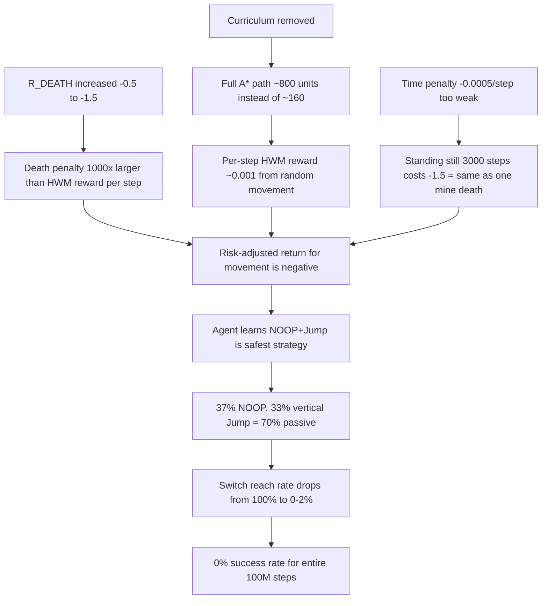

# Run 221 (100M-Step) Training Analysis

## Executive Summary

The run completed 100M steps in 3.2 hours on GH200 (~8,750 FPS -- a 5x throughput improvement over run 220's 37 hours). **The result was again 0% full-level success.** However, the failure mode is entirely different from run 220, and the infrastructure fixes all worked. The agent converged to a **passive risk-aversion policy** (37% NOOP, 33% vertical jump) because the -1.5 death penalty dominates all other reward signals by ~1000:1. Removing the goal curriculum eliminated the one sub-problem the agent could previously solve.

---

## Part 1: What the Fixes Accomplished (Run 220 vs 221)

### Fixes That Worked


| Fix                   | Run 220 (Before)                   | Run 221 (After)                            | Verdict       |
| --------------------- | ---------------------------------- | ------------------------------------------ | ------------- |
| n_epochs 6->3         | value_loss 0.19->8.08 (diverging)  | value_loss 0.063->0.003 (converging)       | **FIXED**     |
| Entropy schedule      | oscillated 0.01/0.02/0.05 randomly | monotonic 0.05->0.02@41M->0.01@82M         | **FIXED**     |
| Dual head removal     | value_loss_int=0.000003 (dead)     | single head, cleaner architecture          | **FIXED**     |
| RND disable           | ran for all 100M steps             | disabled at 50% progress (82M step logged) | **FIXED**     |
| clip_range_vf removal | 0.5 (biased)                       | null                                       | **FIXED**     |
| FPS / throughput      | ~1,650 FPS (37 hours)              | ~8,750 FPS (3.2 hours)                     | **5x faster** |


### Fixes That Backfired


| Change                  | Run 220 (Before)                          | Run 221 (After)                     | Impact                |
| ----------------------- | ----------------------------------------- | ----------------------------------- | --------------------- |
| Removed goal curriculum | 43% curriculum success, 100% switch reach | 0% success, 0-2% switch reach       | **CATASTROPHIC**      |
| R_DEATH -0.5 -> -1.5    | mine_ratio 100%->61%, NOOP 17%->7%        | mine_ratio 100%->95%, NOOP 21%->37% | **COUNTERPRODUCTIVE** |


---

## Part 2: Detailed Metric Trajectories

### Success and Navigation (0.5M / 5M / 10M / 25M / 50M / 75M / 100M)

- **Full-level success**: 0% for the entire 100M steps (identical to run 220)
- **Switch reach rate**: 2% -> 7% -> 2% -> 2% -> 1% -> 1% -> 0% (**massively worse** than run 220's constant 100%)
- **Watermark switch min**: 6 -> 0 -> 0 -> 80 -> 92 -> 92 -> 92 (best distance to switch=92 after 25M, never improved; run 220 had 0.0 always)
- **HWM episode total**: 0.38 -> 0.39 -> 0.50 -> 0.44 -> 0.44 -> 0.38 -> 0.35 (peaked at 10M, then regressed)
- **Forward progress %**: 15.7% -> 3.0% -> 2.4% -> 3.2% -> 2.7% -> 2.3% -> 3.3% (collapsed from 15% to 3% by 5M)

### Action Distribution Collapse

- **NOOP**: 21% -> 10% -> 20% -> 36% -> 30% -> 30% -> 30% (exploded to 36% by 25M, agent learned to stand still)
- **Jump (vertical)**: 13% -> 19% -> 19% -> 25% -> 27% -> 31% -> 33% (increasingly jumping in place)
- **Jump+Right**: 12% -> **31%** -> 27% -> 15% -> 15% -> 13% -> 11% (peaked briefly at 5M then collapsed)
- **Right**: 22% -> 18% -> 15% -> 9% -> 6% -> 4% -> 4% (collapsed)
- The agent briefly tried moving right (5M peak in Jump+Right at 31%), but abandoned it -- likely because rightward movement leads to mine deaths, which cost -1.5.

### Value Function Health

- **Value loss**: 0.063 -> 0.028 -> 0.016 -> 0.004 -> 0.002 -> 0.001 -> 0.003 (converging correctly)
- **Value estimate mean**: -0.24 -> -0.08 (near zero -- correctly estimates the value of "do nothing and eventually die")
- **Total loss**: 11.4 -> 4.5 -> 4.2 -> 2.6 -> 3.0 -> 3.4 -> 3.4 (policy loss dominates)

### Reward Components

- **Episode reward mean**: -1.36 -> -1.30 -> -1.26 -> -1.38 -> -1.50 -> -1.58 -> -1.44 (dominated by death penalty)
- **HWM reward/episode**: 0.002 -> 0.001 -> 0.001 -> 0.001 -> 0.001 -> 0.001 -> 0.001 (microscopic)
- **Terminal reward mean**: -1.50 -> -1.29 (death penalty dominates every episode ending)
- **Mine death ratio**: 100% -> 99.9% -> 99.9% -> 98.6% -> 97.4% -> 96.3% -> 95.3% (barely improved, -1.5 penalty didn't help)

### Eval Bug Status

The eval loop error **reversed direction** but is **still broken**:

- Run 220: `too many values to unpack (expected 5)` -- code tried 4-value unpack, env returned 5
- Run 221: `not enough values to unpack (expected 5, got 4)` -- code was changed to 5-value unpack, but `DummyVecEnv` returns 4 values

The fix changed the wrong direction. `DummyVecEnv` uses the old gym API returning `(obs, reward, done, info)`, not the Gymnasium API's `(obs, reward, terminated, truncated, info)`. The correct fix is in [comprehensive_evaluator.py](npp_rl/evaluation/comprehensive_evaluator.py) lines 778-780, which already has a comment explaining this.

---

## Part 3: Root Cause Analysis

### Causal Chain




### The Reward Magnitude Problem

The per-step reward budget from HWM shaping on the full level:

- Full A* path: ~800 distance units
- Max HWM reward per phase (switch or exit): `HWM_ALPHA * 1.0 = 1.0` (normalized)
- Per step of optimal forward progress: `1.0 / 800 = 0.00125` per unit of progress
- Average random-walk HWM reward per step: ~0.001

Compare this to the death penalty:

- `R_DEATH = -1.5`
- Ratio: `1.5 / 0.001 = 1500:1`

The agent needs to accumulate ~1500 steps of perfect forward progress to offset a single mine death. Since forward progress under random policy is ~3% (data shows `hwm/forward_progress_pct_mean` = 3%), the expected HWM reward per episode is ~0.001 * 1000 steps * 0.03 = 0.03, while the expected death cost is -1.5. **The death penalty is 50x the expected progress reward.**

In run 220 with the 20% curriculum, the path was only ~160 units, so per-step HWM reward was ~0.006 (5x higher) and the death penalty was -0.5 (3x lower). The ratio was ~83:1, which was barely learnable (43% success). Run 221's ratio of 1500:1 is fundamentally unlearnable.

---

## Part 4: Recommendations for Next Run

### Change 1 (CRITICAL): Restore Goal Curriculum with Time-Based Escalation

**Rationale**: The data proves conclusively that the full level is too hard without decomposition. The agent needs the 20% sub-problem as a stepping stone.

**Specific change** in [graph_free_stability_late_stage_figar.json](configs/hyperparameters/graph_free_stability_late_stage_figar.json):

```json
"goal_curriculum_config": {
    "enabled": true,
    "progress_stages": [0.2, 0.4, 0.6, 0.8, 1],
    "advancement_threshold": 0.30,
    "rolling_window": 5000,
    "time_based_escalation_steps": 10000000
}
```

Key differences from previous configs:

- `advancement_threshold: 0.30` (was 0.50 in run 220, never crossed 43%; 0.30 is achievable)
- `time_based_escalation_steps: 10000000` -- advance every 10M steps regardless of success rate, guaranteeing the agent sees all stages by 50M steps

This requires adding `time_based_escalation_steps` support to the `GoalCurriculumCallback`. Re-enable the callback in [callback_factory.py](npp_rl/training/callback_factory.py).

**Expected impact**: Switch reach rate should reach 80%+ within 5M steps at stage 0 (similar to run 220). By 50M steps, agent should have experienced all curriculum stages.

### Change 2 (CRITICAL): Fix Reward Magnitude Balance

**Rationale**: The 1500:1 ratio between death penalty and per-step HWM reward is fundamentally unlearnable. Even with curriculum, the 83:1 ratio in run 220 only achieved 43% success.

**Two complementary changes:**

**a) Reduce R_DEATH from -1.5 to -0.5** in [reward_constants.py](nclone/gym_environment/reward_calculation/reward_constants.py):

```python
R_DEATH = -0.5
```

The -1.5 penalty was counterproductive: mine death ratio improved only 5% (100%->95%) vs 39% improvement in run 220 (100%->61%) with -0.5. The weaker penalty actually worked better because the agent kept exploring rather than freezing.

**b) Increase HWM_ALPHA from 1.0 to 3.0** in [reward_constants.py](nclone/gym_environment/reward_calculation/reward_constants.py):

```python
HWM_ALPHA = 3.0
```

This scales the per-step HWM reward from ~0.001 to ~0.003 on the full path, or ~0.018 at the 20% curriculum stage. Combined with R_DEATH=-0.5, the ratio becomes:

- Stage 0 (20% path): `0.5 / 0.018 = 28:1` -- much more learnable
- Full level: `0.5 / 0.003 = 167:1` -- still hard but curriculum escalation helps

Reward hierarchy becomes: `R_EXIT(5.0) >> R_SWITCH(1.0) >> HWM_max(3.0) >> |R_DEATH|(0.5)`

### Change 3 (HIGH): Fix Eval Bug

**File**: [architecture_trainer.py](npp_rl/training/architecture_trainer.py) line 3500

Change from:

```python
obs, reward, terminated, truncated, info = env.step(action)
```

To:

```python
obs, reward, done, info = env.step(action)
```

`DummyVecEnv` wraps the Gymnasium API and returns old-style 4-tuple `(obs, reward, done, info)`. This is already documented in [comprehensive_evaluator.py](npp_rl/evaluation/comprehensive_evaluator.py) lines 778-780.

### Change 4 (MEDIUM): Increase Time Penalty

**Rationale**: Current -0.0005/step means a 3000-step timeout costs -1.5, identical to dying. With R_DEATH reduced to -0.5, standing still for 1000 steps would cost -0.5 (same as death). The time penalty should make inaction clearly worse than death.

**Change** in [reward_constants.py](nclone/gym_environment/reward_calculation/reward_constants.py):

```python
TIME_PENALTY_PER_STEP = -0.001
```

At -0.001/step, standing still for 500 steps costs -0.5 (same as one death). This means the agent must complete episodes in <500 steps to avoid time penalty exceeding death penalty -- strong incentive to either succeed quickly or die trying.

### Change 5 (LOW): Add NOOP Discouragement

**Rationale**: 37% NOOP rate is a symptom, not a cause. Changes 1-4 should fix the underlying incentive problem. However, if NOOP remains high after fixing the reward balance, consider adding a small NOOP penalty in [main_reward_calculator.py](nclone/gym_environment/reward_calculation/main_reward_calculator.py):

```python
if action == 0:  # NOOP
    reward += NOOP_PENALTY  # -0.0005 per NOOP step
```

Only implement if NOOP > 25% persists at the 10M checkpoint of the next run.

---

## Part 5: What NOT to Change

- **n_epochs=3**: Value function stability is confirmed. Keep.
- **Entropy schedule (0.05->0.02->0.01)**: Working correctly. Keep.
- **Single value head**: Correct simplification. Keep.
- **RND with 50% disable**: Working as designed. Keep.
- **FiGAR macro-actions**: Mechanical function is correct. Keep.
- **clip_range_vf=null**: Correct removal. Keep.
- **vf_coef=0.25**: Appropriate for single head. Keep.
- **IQL escalation**: Not warranted. The problem is reward design, not goal discovery.

---

## Part 6: Early Stopping Criteria for Next Run

At the **5M-step mark** (using faster iteration with 8.7k FPS = ~10 minutes):


| Metric                          | Target | Run 221 at 5M | Run 220 at 5M |
| ------------------------------- | ------ | ------------- | ------------- |
| `hwm/switch_reach_rate`         | > 50%  | 7%            | 100%          |
| `actions/frequency/NOOP`        | < 20%  | 10%           | 7%            |
| `hwm/forward_progress_pct_mean` | > 10%  | 3%            | ~8%           |
| `episode/reward_mean`           | > -0.8 | -1.30         | -1.29         |


At the **10M-step mark**:


| Metric                                  | Target                   | Run 221 at 10M | Run 220 at 10M |
| --------------------------------------- | ------------------------ | -------------- | -------------- |
| `hwm/switch_reach_rate`                 | > 80%                    | 2%             | 100%           |
| `episode/success_rate_curriculum_stage` | > 10%                    | 0%             | 33%            |
| `train/value_loss`                      | < 0.1, stable/decreasing | 0.016          | ~1.5           |
| `efficiency/forward_progress_pct`       | > 5%                     | 0.3%           | ~8%            |
| `actions/frequency/NOOP`                | < 25%                    | 20%            | ~8%            |


**If these are not met at 10M steps (about 19 minutes of wall time), STOP THE RUN.**

---

## Part 7: Summary of All Changes


| Priority | Component       | Current Value  | New Value                                            | File                                         |
| -------- | --------------- | -------------- | ---------------------------------------------------- | -------------------------------------------- |
| P0       | Goal curriculum | enabled: false | enabled: true, threshold: 0.30, time_escalation: 10M | `graph_free_stability_late_stage_figar.json` |
| P0       | R_DEATH         | -1.5           | -0.5                                                 | `reward_constants.py`                        |
| P0       | HWM_ALPHA       | 1.0            | 3.0                                                  | `reward_constants.py`                        |
| P1       | Eval unpack     | 5-value unpack | 4-value unpack                                       | `architecture_trainer.py:3500`               |
| P1       | TIME_PENALTY    | -0.0005        | -0.001                                               | `reward_constants.py`                        |
| P2       | NOOP penalty    | none           | -0.0005 (conditional on 10M check)                   | `main_reward_calculator.py`                  |


