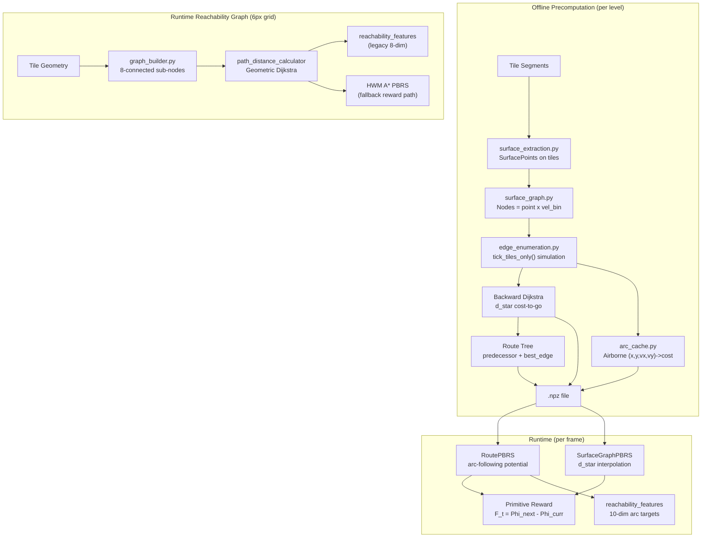
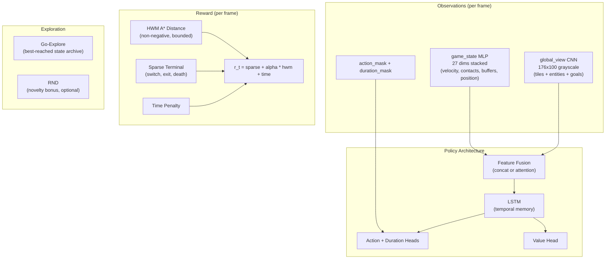

# Value Function System: Comprehensive Audit

## 1. Architecture Overview

The codebase has **two parallel graph systems** that feed into rewards and observations:




**File counts:** ~20 files across `nclone/value_function/` (13 main + tests + visualizers) and `nclone/graph/reachability/` (10 files + Rust accelerators).

---

## 2. Critical Finding: The Entire Surface Graph is Entity-Blind

The edge enumeration pipeline calls `tick_tiles_only()` in the Rust simulator:

```194:202:nclone-native/src/simulator.rs
                for _ in 0..4 {
                    // Skip collide_vs_objects — no entity depenetration or bounce blocks
                    self.ninja.collide_vs_tiles(&self.segment_grid, &self.segments);
                }

                self.post_collision_tiles_only();
```

This means:


| Entity            | In surface extraction?   | In edge simulation?               | In runtime PBRS?              |
| ----------------- | ------------------------ | --------------------------------- | ----------------------------- |
| **Tile geometry** | Yes (sole source)        | Yes (sole collision)              | Indirectly via d*             |
| **Toggle mines**  | No (cost heuristic only) | Pruned/inflated arcs by proximity | Kill-zone masking sets d*=inf |
| **Bounce blocks** | **No**                   | **No**                            | **No**                        |
| **Thwumps**       | **No**                   | **No**                            | **No**                        |
| **Launch pads**   | **No**                   | **No**                            | **No**                        |


**Bounce blocks** provide 4-sided platforms the ninja can jump from and wall-jump off of with spring physics. **Thwumps** have one safe face the ninja can use as floor/wall/ceiling, plus a lethal charging face. **Neither entity's surfaces exist anywhere in the value function.**

---

## 3. How Dynamic Entities Actually Work

From the ninja physics (`[ninja.py](nclone/nclone/ninja.py)` `think()` method, lines ~940-1061):

- **Movement is fully determined by:** `xspeed`, `yspeed`, `applied_gravity`, `applied_drag`, `floor_count`, `floor_normalized_x/y`, `ceiling_count`, `airborn`, `walled`, `wall_normal`, `jump_duration`, `state` (0-5), and the 4 buffers (`jump_buffer`, `floor_buffer`, `wall_buffer`, `launch_pad_buffer`).
- **Entities only participate in `collide_vs_objects` and `post_collision`** -- they set `floor_count`, `walled`, `wall_normal`, provide velocity impulses (bounce), and trigger kills (thwump lethal face, mine overlap). They do NOT change the `think()` state machine itself.
- **Toggle mines** (`entity_toggle_mine.py`): Not physically collidable. Only `logical_collision` -- kills if state==0 on overlap, toggles state. Does not block movement geometrically.
- **Bounce blocks** (`entity_bounce_block.py`): Physical + logical. Provides depenetration, spring velocity impulse, and wall normals for `walled`/wall-slide. Excluded from crush accumulation.
- **Thwumps** (`entity_thwump.py`): Physical + logical. Square depenetration, wall normals from safe faces, lethal segment on charging face. Moves via `think()` on LOS trigger.

---

## 4. The User's Insight is Correct

The ninja's action space and movement physics are **identical regardless of what it's colliding with**. A floor from a tile, a bounce block top face, and a thwump's safe upward face all produce `floor_count > 0` with a floor normal -- and `think()` treats them identically. The same is true for walls.

What differs is:

1. **Where** the surfaces are (static tiles vs. moving entities)
2. **When** they exist (thwumps move, bounce blocks have spring displacement, toggle mines change state)
3. **Side effects** of contact (bounce impulse, toggle mine state change, thwump kill on wrong face)

---

## 5. What the Agent Currently Receives

### Observations (124+ dims, graph-free mode)

- **game_state** (27 dims): velocity, movement state one-hot, airborne, buffers, jump_duration, contacts, normals, walled, physics-derived, position, time
- **reachability_features** (10 dims): RoutePBRS arc targets (launch/land offsets, vx_error, jump_hold, progress, phase) OR legacy graph distances
- **spatial_context** (84 dims): 8x8 local tile grid + 5 nearest mines with state + velocity dot direction
- **mine_sdf** (3 dims): signed distance to nearest mine + escape gradient

**Notable absences:** No bounce block positions/states, no thwump positions/orientations/charge states, no launch pad positions, no entity-specific contact information.

### Rewards

- **Sparse:** RewardMachine events (switch, exit, death)
- **PBRS:** `F_t = Phi(s') - Phi(s)` per frame from precomputed VF
- **Time penalty:** per frame

---

## 6. Problems with the Current Approach

### 6.1 Entity blindness (fundamental)

The surface graph has zero knowledge of entity surfaces. On levels with bounce blocks or thwumps, the "optimal route" computed by Dijkstra may be completely wrong -- it cannot plan through bounce block platforms or around thwumps. The PBRS potential will provide misleading gradients near these entities.

### 6.2 Static precomputation vs. dynamic world state

The `.npz` is frozen at level load time:

- **Toggle mines:** When a ninja touches a safe mine, it becomes deadly. The precomputed d* doesn't reflect this -- it uses a fixed "initially deadly" mask. The comment at [precompute_cli.py:308](nclone/nclone/value_function/precompute_cli.py) acknowledges this: *"because touching them toggles their state and endangers the return path."*
- **Thwumps:** Move position at runtime (charge on LOS). Precomputed surfaces don't exist for them at all.
- **Bounce blocks:** Spring displacement changes effective surface position.

### 6.3 Massive complexity for marginal benefit

The surface graph pipeline has ~4,000 lines across 13+ files, requires per-level offline precomputation with multiprocessing simulation, produces large `.npz` files, and has multiple fallback chains (arc cache miss -> neighborhood search -> airborne evaluator -> raw d* fallback). This complexity exists to add velocity awareness to the cost-to-go, but:

- PBRS only needs Phi(s) to be **monotonically correlated** with closeness to goal -- it does not require the exact optimal cost-to-go.
- The 6px reachability graph already provides geometric path distances that serve as reasonable potentials.
- The velocity-aware improvement over position-only PBRS has not been validated against the complexity cost.

### 6.4 Dual redundant graph systems

The codebase maintains two separate graph systems (sub-tile reachability + surface velocity graph) with overlapping purpose but incompatible representations. This creates maintenance burden and conceptual confusion about which system drives what.

---

## 7. Proposed Replacement: Vision + Proprioception + LSTM + HWM

### Design Philosophy

Instead of encoding physics knowledge into the reward function (PBRS, analytical cost-to-go, gap analysis), keep the reward simple and let the agent **learn** the physics from rich observations -- the same way humans learn N++ by watching the screen and feeling the controller.

The entire value function pipeline (surface graph, platform graph, analytical PBRS) is replaced by:

1. *HWM A distance reward** (already exists in `[hwm_shaping.py](nclone/nclone/gym_environment/reward_calculation/hwm_shaping.py)`)
2. **Global view CNN** for level geometry + entity awareness (already rendered, infrastructure exists)
3. **game_state vector** for precise physics (velocity, contacts, buffers -- the "proprioception")
4. **LSTM** for within-episode temporal memory (learns speed buildup, path memory)
5. **Go-Explore** for cross-episode memory (best-reached states, successful route discovery)




### Why This Works

**Entity awareness for free:** The `global_view` renders ALL entities in their current visual state -- toggle mines (color = deadly/safe), bounce blocks, thwumps (idle/charging), launch pads. The CNN learns to recognize them without hand-crafted features. New entity types require zero code changes.

**Velocity awareness via LSTM:** The agent needs to learn "I should build speed before this gap." The LSTM sees a sequence of `game_state` vectors containing velocity. It can learn: "my speed has been increasing for N frames, I'm ready to jump" or "I'm still too slow, keep running." This replaces the analytical speed-buildup cost model.

**Backtracking via value function:** With HWM reward, the value function learns that states near a gap with low speed have high expected future return IF the agent backtracks to build speed (because future HWM improvement comes after crossing). The LSTM's temporal context helps: it can distinguish "low speed, just arrived at gap" (should backtrack) from "low speed, already built speed and jumped" (different situation).

**Impossible gaps via Go-Explore:** Cross-episode memory lets the agent remember: "I've explored that direction and never got further. But when I went down and around, I reached a new HWM." Go-Explore resets to the best-reached states, accelerating discovery of detour routes around impossible gaps.

### Observation Architecture

**Keep:**

- **game_state** (27 dims): velocity(2), movement_state(4), airborne(1), buffers(3), jump_duration_remaining(1), contacts(3), normals(3), walled(1), physics_derived(3), position(2), time_remaining(1). This is the "proprioception" -- precise physics state the CNN can't extract from pixels.
- **global_view** (176x100x1 grayscale): Already rendered by `[observation_processor.py](nclone/nclone/gym_environment/observation_processor.py)`. Shows the full level at 1/6th resolution including all entities in their current visual state. Processed by `GlobalViewCNN` in `[configurable_extractor.py](npp-rl/npp_rl/feature_extractors/configurable_extractor.py)`.
- **action_mask / duration_mask**: Unchanged.

**Remove** (replaced by global_view CNN):

- **spatial_context** (84 dims): 8x8 local tile grid + mine features. The global_view shows the same geometry plus entities the spatial_context misses.
- **mine_sdf** (3 dims): Mine distance + gradient. The CNN sees mines in the global_view; their danger is learned from death episodes.
- **reachability_features** (10 dims): Path distances, next_hop direction. The CNN sees the spatial relationship between ninja and goals directly. The value function learns path planning from HWM reward.
- **physics_derived** (3 dims): horizontal_range, max_jump_height, time_to_ground. Rough approximations of what the LSTM learns precisely from game_state sequences.

**Net effect:** 124 dims of hand-crafted features --> 27 dims of game_state + 176x100 image. The observation is simpler, more general, and entity-aware by construction.

### LSTM Integration

**Where:** Between the `ConfigurableMultimodalExtractor` output (fused feature vector) and the policy/value heads in `FiGARActorCriticPolicy` (`[figar_ppo.py](npp-rl/npp_rl/agents/figar_ppo.py)`).

**What it replaces:** Frame stacking (currently supported by `[frame_stack_wrapper.py](nclone/nclone/gym_environment/frame_stack_wrapper.py)`). The LSTM subsumes frame stacking with a learned, variable-length memory instead of a fixed-window concatenation.

**What it provides:**

- **Velocity tracking:** "Am I accelerating or decelerating?" from game_state velocity sequence
- **Speed buildup memory:** "I've been running right for 40 frames" -- enables the value function to predict gap-crossing success
- **Path memory:** "I tried going left and hit a wall" -- within-episode route refinement
- **Jump phase tracking:** "I'm in the middle of a jump arc" -- combines with jump_duration and velocity for precise control

**Hidden state management:**

- Reset LSTM hidden state on episode boundaries (death, win, truncation)
- For Go-Explore resets to archived states, also reset LSTM hidden state (the agent re-learns temporal context from the reset point)
- Store hidden state in the rollout buffer for correct backpropagation through time (BPTT)

**Architecture:** Single-layer LSTM with hidden size matching the fused feature dimension (e.g., 256). SB3's `RecurrentPPO` from `sb3-contrib` provides the infrastructure, but may need adaptation for FiGAR's dual (action, duration) heads.

### HWM Reward as Primary Signal

The existing HWM system in `[hwm_shaping.py](nclone/nclone/gym_environment/reward_calculation/hwm_shaping.py)` and `[main_reward_calculator.py](nclone/nclone/gym_environment/reward_calculation/main_reward_calculator.py)` is already well-tuned:

- `HWM_ALPHA = 3.0` (shaping weight)
- Bounded cumulative: total HWM <= 1.0 per phase (normalized by initial distance)
- Non-exploitable: cycling distance yields reward once then zeros
- Two-phase: switch objective then exit objective
- Sparse terminals: `R_EXIT=5.0`, `R_SWITCH=1.0`, `R_DEATH=-0.5`, `R_DEATH_MINE=-3.0`
- Time penalty: `-0.002/step`
- Backtrack penalty: `-0.0004/step` (nudge, not harsh)

**Change needed:** Remove the precomputed PBRS branch from `[base_environment.py](nclone/nclone/gym_environment/base_environment.py)` `step()`. Currently, when `_current_precomputed_pbrs` is set, the env uses `PrimitiveRewardCalculator` with per-frame PBRS. The new system uses `RewardCalculator` (HWM path) exclusively. The `PrimitiveRewardCalculator` PBRS path becomes dead code.

**Distance metric note:** The HWM uses A* distance on the 6px reachability graph, which goes through air (tile type 0 is fully traversable). This means the agent can get HWM reward for "approaching" a chasm it can't cross. This is acceptable: the agent learns from experience that approaching the chasm leads nowhere (no further HWM improvement), and discovers detours that do yield HWM progress. Keep the 6px graph for HWM distance computation only.

### Go-Explore Integration

`GoExploreCallback` already exists in the codebase. Enhance it for this architecture:

- **Archive criterion:** HWM distance to current goal (lower = better). Store the state (simulator snapshot) at each new HWM minimum.
- **Reset mechanism:** Periodically reset some environments to archived states, letting the agent explore from previously-best positions rather than always from spawn.
- **LSTM compatibility:** On Go-Explore reset, clear the LSTM hidden state. The agent rebuilds temporal context from the reset point -- a few frames of "orientation" before productive exploration.
- **Diversity:** Archive multiple states along the route (not just the global best), so the agent explores from different positions. Bin by HWM distance to ensure coverage.

This provides the "cross-episode memory" that mimics a human remembering: "I know I can get to this ledge, now let me figure out the next part."

### What To Remove

**Surface graph pipeline** (~4000 lines):

- `value_function/surface_extraction.py`, `surface_graph.py`, `edge_enumeration.py`, `arc_cache.py`
- `value_function/precompute_cli.py`, `precomputed_pbrs.py`, `.npz` files
- `value_function/route_extraction.py`, `route_pbrs.py`, `route_overlay_draw.py`
- `value_function/value_landscape.py`, `visualize_route_interactive.py`, `visualize_mine_*.py`
- `value_function/airborne_evaluator.py`, `demo_ingestion.py`, `two_phase_pbrs.py`, `neural_value_pbrs.py`

**Hand-crafted feature pipelines** (replaced by global_view CNN):

- `gym_environment/spatial_context.py` (84-dim tile grid + mine features)
- `graph/reachability/feature_computation.py` (8-dim reachability features)
- `graph/reachability/directional_connectivity.py` (platform ahead/below)
- `graph/reachability/mine_proximity_cache.py` (mine cost multipliers)
- `nclone-native/src/mine_sdf.rs` (mine SDF computation)
- Physics-derived features in `npp_environment._compute_physics_derived_features()`

**Keep** (still needed for HWM distance):

- `graph/reachability/graph_builder.py` (6px grid for A* distance)
- `graph/reachability/path_distance_calculator.py` (A* pathfinding)
- `graph/reachability/path_distance_cache.py` (distance caching)
- `graph/reachability/shared_level_cache.py` (level cache for distances)
- `nclone-native/src/level_cache.rs` (Rust distance cache)
- `analytical_physics/jump_hull.py` (keep for potential future use, no runtime cost)

---

## 8. Implementation Plan

### Stage 1: Observation + Reward Simplification

1. Enable `global_view` as primary visual observation in the default architecture config
2. Remove the `_current_precomputed_pbrs` branch from `base_environment.step()` -- HWM reward path only
3. Disable `spatial_context`, `mine_sdf`, `reachability_features` from the observation space
4. Keep `game_state` (27 dims) unchanged
5. Validate: train on a simple tile-only level with global_view + game_state + HWM reward

### Stage 2: LSTM Policy

1. Add LSTM layer to `FiGARActorCriticPolicy` between feature extractor and heads
2. Adapt `PrimitiveSMDPRolloutBuffer` to store LSTM hidden states
3. Handle hidden state reset on episode boundaries and Go-Explore resets
4. Remove `FrameStackWrapper` (LSTM subsumes frame stacking)
5. Validate: confirm LSTM learns velocity tracking (agent accelerates before gaps)

### Stage 3: Go-Explore Enhancement

1. Enhance `GoExploreCallback` with HWM-distance-binned state archive
2. Implement periodic reset to archived states with LSTM hidden state clearing
3. Add diversity mechanism (archive states at multiple HWM distances along the route)
4. Validate: agent discovers detour routes around impossible gaps faster than without Go-Explore

### Stage 4: Deprecation

1. Remove surface graph pipeline (~4000 lines)
2. Remove hand-crafted feature pipelines (~1500 lines)
3. Remove related tests, visualizers, and CLI tools
4. Update documentation

