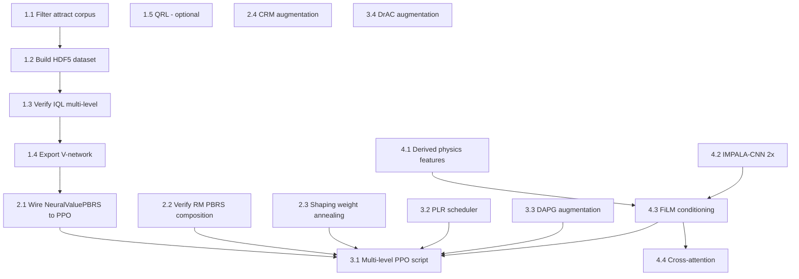

# Epic: Generalizable N++ RL Agent via Learned Value Functions

**Source research:** [`docs/research-03-08-2026.md`](research-03-08-2026.md)

**Core thesis:** Replace level-specific A\* HWM shaping + RFCL with a universal learned value function (IQL or QRL) used as a frozen PBRS potential, trained across 250K+ attract demos, and deploy online as FiGAR-PPO with Prioritized Level Replay across 200+ levels simultaneously.

---

## Status of Existing Infrastructure

| Component | Status | Location |
|---|---|---|
| IQL trainer (tau=0.9, AWR) | **Exists** | `nclone/offline_rl/algorithms/iql.py` |
| IQL networks + TileEncoder | **Exists** | `nclone/offline_rl/networks/` |
| Demo dataset pipeline (HDF5, 250K+ files) | **Exists** | `nclone/offline_rl/dataset/` |
| V-network export for PBRS | **Exists** | `nclone/offline_rl/export.py` |
| 3-state reward machine | **Exists** | `nclone/gym_environment/reward_calculation/reward_machine.py` |
| NeuralValuePBRS adapter | **Exists** | `nclone/value_function/neural_value_pbrs.py` |
| TwoPhaseValuePBRS + factory | **Exists** | `nclone/value_function/two_phase_pbrs.py` |
| PBRSCalculator with alpha annealing | **Exists** | `nclone/gym_environment/reward_calculation/pbrs_potentials.py` |
| FiGAR-PPO agent + SMDP buffer | **Exists** | `npp_rl/agents/figar_ppo.py`, `smdp_rollout_buffer.py` |
| Demo augmentation callback (PPO) | **Exists** | `npp_rl/callbacks/demo_callback.py` |
| Level scheduler (active/solved/stalled) | **Exists** | `npp_rl/training/level_scheduler.py` |
| Multi-modal feature extractor framework | **Exists** | `npp_rl/feature_extractors/configurable_extractor.py` |
| FiGAR policy (separate action/duration heads) | **Exists** | `npp_rl/agents/figar_policy.py` |
| Counterfactual RM (CRM) 3x data efficiency | **Missing** | — |
| PLR with \|GAE\| level scoring | **Missing** | — |
| DrAC augmentation (crop/translate/color) | **Missing** | — |
| IMPALA-CNN 2x width level encoder | **Missing** | — |
| FiLM velocity conditioning | **Missing** | — |
| Cross-attention (agent query → level keys/values) | **Missing** | — |
| Derived physics features (KE, time-to-ground, etc.) | **Missing** | — |
| DAPG auxiliary BC loss with decay schedule | **Partial** | `npp_rl/callbacks/demo_callback.py` (buffer injection only) |
| PBRS shaping weight annealing (α 1.0→0.1) | **Partial** | `pbrs_potentials.py` (IQL expectile tau, not shaping α) |
| Reward clipping \|γΦ(s')−Φ(s)\| ≤ 2.0 | **Partial** | Needs verification in `pbrs_potentials.py` |

---

## Phase 1: Offline Value Function Pre-training

**Goal:** Produce a frozen, goal-conditioned V(s) network trained on 250K+ attract demos across many levels, exported for use as a PBRS potential.

### Task 1.1 — Filter and audit attract demo corpus

**Status:** Infrastructure exists. Dataset scale verification needed.

- `nclone/offline_rl/dataset/filter_attracts.py` filters the raw attract corpus to levels with exactly 1 exit door + 1 switch + allowed entities (toggle mines, gold).
- Run `filter_attracts` against the full corpus to produce a filtered symlink directory. Verify minimum 50K qualified episodes across 500+ distinct levels.
- Ensure `nclone/offline_rl/dataset/build_dataset_cli.py` can ingest both `npp_attract` (no extension) and `.replay` binary formats.

**Key file:** `nclone/offline_rl/dataset/filter_attracts.py` — `ALLOWED_ENTITY_TYPES`, CLI args `--source`, `--output`, `--workers`.

### Task 1.2 — Build cross-level HDF5 dataset

**Status:** Infrastructure exists. Needs to be executed at scale.

- `nclone/offline_rl/dataset/transition_extractor.py` — `TransitionExtractor.extract_from_file()` extracts `(s, a, r, s', done)` per episode. State: 11D ninja physics + 24D nearest-8-mine features + `LevelStaticData` (tile_grid, switch_overlay, exit_overlay).
- `nclone/offline_rl/dataset/replay_dataset.py` — `OfflineRLDataset` (HDF5, cross-level UVFA). `StreamingDatasetBuilder` for parallel writes.
- Assign sparse rewards: **+1 hit switch, +1 reach exit, −1/step** (time-optimal pressure per research doc §Phase 1).
- Produce two goal variants per episode: one conditioned on switch goal, one on exit goal (for two-phase PBRS).

**Key files:**
- `nclone/offline_rl/dataset/transition_extractor.py` — `EpisodeTransitions`, `LevelStaticData`
- `nclone/offline_rl/dataset/build_dataset_cli.py` — `build_dataset_parallel()`

### Task 1.3 — Verify and extend IQL for multi-level goal conditioning

**Status:** IQL exists with UVFA support. Validate config matches research spec.

Current architecture:
- `AgentStateEncoder`: 11D physics + 24D mines → 256D (LayerNorm throughout)
- `TileEncoder`: 42×23 tile grid + switch overlay + exit overlay → 128D (global avg pool)
- Combiner: concat(256, 128) → 512 → V/Q/π heads

Verify and tune:
- `IQLConfig.expectile_tau = 0.9` (research specifies τ=0.9 for near-optimal expert data)
- `IQLConfig.learning_rate = 3e-4`, `batch_size = 256` (research §Phase 1; current default is 1024 — reduce for better cross-level generalization signal)
- Training duration: ~300K gradient steps with held-out demo validation loss monitoring
- `use_tile_encoder = True` must be enabled for cross-level transfer

The `TileEncoder` uses global average pooling already, which aligns with the Impoola-CNN recommendation in the research doc (reduces translation sensitivity).

**Key files:**
- `nclone/offline_rl/algorithms/iql.py` — `IQLTrainer`, `IQLConfig`
- `nclone/offline_rl/networks/value_networks.py` — `IQLNetworks`, `AgentStateEncoder`
- `nclone/offline_rl/networks/tile_encoder.py` — `TileEncoder`
- `nclone/offline_rl/train_cli.py` — training loop, TensorBoard, AMP, checkpoint resume

### Task 1.4 — Export V-network for PBRS

**Status:** `export.py` exists. Validate exported format matches `NeuralValuePBRS` loader.

- `nclone/offline_rl/export.py` — `export_v_network()` saves the V-head + encoders to `.pt`
- `nclone/value_function/neural_value_pbrs.py` — `NeuralValuePBRS` loads the checkpoint, caches CNN output per level, runs MLP per step
- Verify that `NeuralValuePBRS.set_level()` correctly accepts the new multi-level `TileEncoder` checkpoint format
- Test: load checkpoint, call `set_level(tile_grid, switch_pos, exit_pos, mine_positions)`, check `get_potential(state)` returns reasonable values

**Key files:**
- `nclone/offline_rl/export.py`
- `nclone/value_function/neural_value_pbrs.py` — `NeuralValuePBRS.set_level()`, `get_potential()`
- `nclone/value_function/two_phase_pbrs.py` — `create_neural_pbrs()` factory

### Task 1.5 — (Optional) QRL quasimetric distance function

**Status:** Not in codebase. Medium-high complexity.

If pursuing QRL (Wang et al. ICML 2023) over IQL fallback:
- Implement interval quasimetric embeddings: encoder `f_θ(s)` + `g_θ(s)` → `d_θ(s1, s2) = max(0, f(s2) - g(s1))`
- Training loss: `L = E[max(0, c(s,s') - d_θ(s,s'))] + λ·triangle_inequality_violation`
- Two separate quasimetric networks: `d_θ(s, g_switch)` and `d_θ(s, g_door)`
- Best treated as a new module `nclone/offline_rl/algorithms/qrl.py`

**Dependency:** Can proceed with IQL (Task 1.3) first; QRL is a drop-in replacement for the V-network.

---

## Phase 2: PBRS Construction and Reward Machine Integration

**Goal:** Wire the frozen IQL V-network into the existing reward machine and PBRS pipeline, replacing HWM A\* shaping.

### Task 2.1 — Connect NeuralValuePBRS to FiGAR-PPO training

**Status:** `NeuralValuePBRS` exists. Integration into PPO training path needs wiring.

The existing environment path `base_environment._try_load_value_function_pbrs` loads `TwoPhaseValuePBRS` from precomputed `.npz` files. Extend this to also accept `NeuralValuePBRS` from a checkpoint path:
- Add a `neural_pbrs_checkpoint` config option to `EnvironmentConfig` (`nclone/gym_environment/config.py`)
- In `base_environment._try_load_value_function_pbrs`, check for neural checkpoint first, fall back to surface PBRS, then HWM
- Use `create_neural_pbrs()` from `nclone/value_function/two_phase_pbrs.py`

**Key files:**
- `nclone/gym_environment/config.py` — add `neural_pbrs_checkpoint: Optional[str]` field
- `nclone/gym_environment/base_environment.py` — `_try_load_value_function_pbrs()`
- `nclone/value_function/two_phase_pbrs.py` — `create_neural_pbrs()` factory

### Task 2.2 — Verify reward machine PBRS composition is correct

**Status:** Reward machine and PBRS calculator both exist. Verify end-to-end correctness.

The reward machine (`reward_machine.py`) provides the 3-state FSM. `PBRSCalculator` in `pbrs_potentials.py` must compose these correctly:

```
R_shaped = R_env + α × [γΦ(s', u') − Φ(s, u)]
Φ(s, u) = Phi_state(s, u) + Phi_phase(u)   # via RewardMachine.get_total_potential()
Φ(terminal) = 0                              # enforced by RewardMachine
```

Verify:
- `PBRSCalculator` calls `reward_machine.get_total_potential(phi_state, is_terminal=True)` at death/timeout
- PBRS clipping: `|γΦ(s') − Φ(s)| ≤ 2.0` — add if not present
- `γ` in PBRS calculation exactly matches online PPO discount factor (both 0.99)

**Key files:**
- `nclone/gym_environment/reward_calculation/pbrs_potentials.py` — `PBRSCalculator`
- `nclone/gym_environment/reward_calculation/reward_machine.py` — `RewardMachine.get_total_potential()`
- `nclone/gym_environment/reward_calculation/reward_constants.py` — `GAMMA`

### Task 2.3 — Add shaping weight annealing (α: 1.0 → 0.1)

**Status:** `PBRSCalculator` has `iql_alpha` and annealing but this governs IQL blend, not the shaping weight. Need a separate `alpha_shaping` parameter.

- Add `alpha_shaping` parameter to `PBRSCalculator` (or `RewardConfig`)
- Anneal linearly from 1.0 → 0.1 over first 60% of training steps
- Pass `total_training_steps` to the calculator so it can compute the schedule
- The research specifically flags that "with function approximation the learned potential introduces subtle biases" — the annealing schedule is important

**Key files:**
- `nclone/gym_environment/reward_calculation/pbrs_potentials.py` — `PBRSCalculator`
- `nclone/gym_environment/reward_calculation/reward_config.py` — `RewardConfig`

### Task 2.4 — Implement CRM (Counterfactual Experiences for Reward Machines)

**Status:** Not implemented. 3x data efficiency improvement.

CRM (Icarte et al. 2022): when replaying any transition `(s, a, s', u)`, also generate synthetic updates for hypothetical RM states where the same transition occurred from a different RM state.

For N++'s 3-state machine this means: for each real transition, generate 2 additional synthetic transitions (one per non-current RM state), computing hypothetical rewards and Φ values.

New module: `nclone/gym_environment/reward_calculation/crm_augmentor.py`
- `CRMAugmentor.augment_batch(transitions, reward_machine)` → 3× batch
- Each augmented transition recomputes `r_shaped` and `Phi(s, u_hypothetical)`

Integrate into PPO rollout buffer collection: `npp_rl/agents/figar_ppo.py` or the training loop.

**Key files to reference:**
- `nclone/gym_environment/reward_calculation/reward_machine.py` — RM state constants
- `npp_rl/agents/smdp_rollout_buffer.py` — buffer structure for SMDP transitions

---

## Phase 3: Online Multi-level PPO Training

**Goal:** Replace single-level SAC-RFCL with multi-level FiGAR-PPO using PLR curriculum, DAPG demo augmentation, and DrAC augmentation.

### Task 3.1 — Build multi-level PPO training script

**Status:** FiGAR-PPO exists. Multi-level training script needs to be written.

The existing training scripts target single-level (or SAC-RFCL). Need a new entry point:
`npp_rl/scripts/train_ppo_multilevel.py`

Key responsibilities:
- Accept a level directory with 200+ level files
- Instantiate `N` parallel `NppEnvironment` instances, each with a NeuralValuePBRS loaded
- Use `LevelScheduler` (`npp_rl/training/level_scheduler.py`) for initial level assignment
- Wire up `FiGARPPO` with the upgraded feature extractor (Phase 4)
- Attach `DemoAugmentationCallback` for DAPG-style demo mixing
- Attach new `PLRCallback` (Task 3.2)
- Drop RFCL — with dense PBRS rewards, reverse curriculum is not needed

**Key files:**
- `npp_rl/agents/figar_ppo.py` — `FiGARPPO`
- `npp_rl/agents/figar_policy.py` — `FiGARActorCriticPolicy`
- `npp_rl/training/level_scheduler.py` — `LevelScheduler`
- `nclone/gym_environment/environment_factory.py` — `create_training_env()`

### Task 3.2 — Implement Prioritized Level Replay (PLR)

**Status:** Not implemented. `LevelScheduler` has active/solved/stalled logic but not |GAE|-based scoring.

PLR (Jiang et al. ICML 2021) scores each level by the mean absolute GAE advantage of recent trajectories:
`score(level) = E[|Â_t|]` over recent rollouts

New class: `npp_rl/training/plr_scheduler.py`
- `PLRScheduler` replaces or wraps `LevelScheduler`
- Buffer of size 4000 level scores, updated after each rollout
- Sampling: P(level) ∝ score(level)^(1/temperature) with temperature=0.3
- Staleness coefficient 0.3: mix score-based and recency-based sampling
- Replay probability 0.95: with probability 0.95, sample from PLR buffer; otherwise pick a new level
- Seeding: start with easiest 20% of levels (shortest expert completion time from demo dataset)

**Key files:**
- `npp_rl/training/level_scheduler.py` — reference for interface contract
- `npp_rl/agents/smdp_rollout_buffer.py` — source of GAE values per level

### Task 3.3 — Upgrade DAPG demo augmentation in PPO

**Status:** `DemoAugmentationCallback` exists (buffer injection). Needs DAPG auxiliary loss.

Current `npp_rl/callbacks/demo_callback.py` injects demo transitions into the rollout buffer. True DAPG-style requires:
- Phase 1: BC pre-training — run supervised learning on demo actions before online RL starts
- Phase 2 (online): auxiliary BC loss added to PPO loss: `L_total = L_PPO + λ_dapg(t) · L_BC`
- Decay schedule: `λ_dapg(t) = λ_0 · decay^t` (exponential decay over training)

Extend `DemoAugmentationCallback`:
- Add `pretrain_steps` argument: if >0, run BC pre-training before env interaction
- Add `dapg_lambda_0` and `dapg_decay` arguments for auxiliary loss weight
- Modify `_on_rollout_end` to compute `L_BC` on sampled demo transitions and add to optimizer step

**Key files:**
- `npp_rl/callbacks/demo_callback.py` — `DemoAugmentationCallback`
- `nclone/replay/demonstration_buffer.py` — `DemonstrationBuffer` (BC data source)

### Task 3.4 — Implement DrAC data augmentation

**Status:** Not implemented. ~40% improvement on Procgen test performance.

UCB-DrAC (Raileanu et al., NeurIPS 2021) automatically selects the best augmentation per training phase via UCB bandit. For N++, relevant augmentations:
- **Crop**: random crop of the local tile window (translational invariance)
- **Translate**: small pixel shift of the entire level observation
- Optionally: horizontal flip (N++ levels may have left-right symmetry)

New module: `npp_rl/training/drac_augmentor.py`
- `DRaCAugmentor`: UCB bandit over augmentation types, applies to observation tensors
- Regularization: both policy and value function trained with augmented obs to enforce invariance
- Integration point: inside the PPO training update in `FiGARPPO` or as a wrapper

**Key files:**
- `nclone/gym_environment/observation_processor.py` — observation format (dict with game_state, spatial_context, etc.)
- `nclone/gym_environment/spatial_context.py` — local tile grid structure

---

## Phase 4: Architecture Upgrades

**Goal:** Replace the current CNN and MLP encoders with IMPALA-CNN 2×, FiLM velocity conditioning, and cross-attention. Add derived physics features.

### Task 4.1 — Derived physics features for state encoder

**Status:** Not implemented. Low effort, high impact on value function quality.

Replace raw `(vx, vy)` in the state encoder with computed features that directly correspond to game-relevant quantities:

```python
kinetic_energy = 0.5 * (vx**2 + vy**2)
momentum_direction = atan2(vy, vx)
time_to_ground = (-vy + sqrt(vy**2 + 2*g*y)) / g   # from current y, vy, GRAVITY_FALL
max_jump_height = -(vy**2) / (2*GRAVITY_JUMP) if vy < 0 else jump_frames_remaining * GRAVITY_JUMP / 2
horizontal_range = vx * time_to_ground * (1 - DRAG_REGULAR)  # approximate
```

Use constants from `nclone/constants/physics_constants.py`: `GRAVITY_FALL`, `GRAVITY_JUMP`, `MAX_HOR_SPEED`, `MAX_JUMP_DURATION`.

Add as a preprocessing layer in the IQL `AgentStateEncoder` (`nclone/offline_rl/networks/value_networks.py`) and in the online feature extractor.

**Key files:**
- `nclone/offline_rl/networks/value_networks.py` — `AgentStateEncoder`
- `nclone/gym_environment/observation_processor.py` — `process_game_state()`
- `nclone/constants/physics_constants.py` — physics constants

### Task 4.2 — Upgrade level encoder to IMPALA-CNN 2× width

**Status:** Current `LevelContextCNN` is a simple 3-conv network. Needs upgrade.

Replace `npp_rl/feature_extractors/level_context_encoder.py`'s `LevelContextCNN` with an IMPALA-CNN:

```
IMPALA-CNN architecture (Espeholt et al., 2018):
  3 residual blocks: channels [64, 128, 128] (2x the base [32, 64, 64])
  Each block: Conv3×3 → MaxPool → 2×ResBlock
  Output: GlobalAveragePool → flatten
```

Replace MaxPool with GlobalAveragePool ("Impoola" variant per Janer et al. 2025) for better generalization with 35% fewer params. The `TileEncoder` in `nclone/offline_rl/networks/tile_encoder.py` already uses global average pooling — use the same design principle here.

The upgraded encoder should be shared between the V-network (for IQL) and the policy/value network (for online PPO). Consider extracting to `nclone/models/impala_cnn.py` for cross-repo sharing.

**Key files:**
- `npp_rl/feature_extractors/level_context_encoder.py` — `LevelContextCNN` (replace)
- `nclone/offline_rl/networks/tile_encoder.py` — reference for global avg pool pattern

### Task 4.3 — Implement FiLM velocity conditioning

**Status:** Not implemented. The key architectural innovation per research doc.

FiLM (Perez et al., AAAI 2018): `H_modulated = γ(v) ⊙ H_level + β(v)`

After the IMPALA-CNN produces spatial feature maps `H_level ∈ R^{C×H×W}`, a small MLP called `FiLM_generator` takes the physics state (including derived features from Task 4.1) and outputs per-channel scale `γ ∈ R^C` and shift `β ∈ R^C`.

```python
class FiLMGenerator(nn.Module):
    def __init__(self, physics_dim, n_channels):
        self.mlp = nn.Sequential(
            nn.Linear(physics_dim, 128), nn.ReLU(),
            nn.Linear(128, 2 * n_channels)  # gamma and beta
        )
    def forward(self, physics_state):
        params = self.mlp(physics_state)
        gamma, beta = params.chunk(2, dim=-1)
        return gamma, beta
```

Apply before GlobalAveragePool so that velocity modulates the spatial value landscape before aggregation.

New module: `npp_rl/feature_extractors/film_conditioned_encoder.py`
- `FiLMConditionedLevelEncoder`: IMPALA-CNN backbone + FiLM generator + GAP
- Replace `LevelContextCNN` in `SACFeatureExtractor` and the PPO feature extractor

**Key files:**
- `npp_rl/feature_extractors/level_context_encoder.py` — current encoder (replace)
- `npp_rl/feature_extractors/sac_feature_extractor.py` — integration point
- `nclone/gym_environment/constants.py` — feature dimensions

### Task 4.4 — Cross-attention between agent state and level features

**Status:** Not implemented. Complements FiLM conditioning.

After FiLM modulation and GAP produces a level feature vector `z_level ∈ R^D`, apply cross-attention:
- Query: agent physics state → linear projection → `q ∈ R^{d_k}`
- Keys/Values: spatial feature map from IMPALA-CNN (before GAP) → reshape to sequence → `K, V ∈ R^{N×d_k}`
- Output: attention-weighted sum → fused agent-level feature

This allows the value function to focus on the nearest platform, the current gap, or the objective, depending on agent momentum. Can be implemented as a single `nn.MultiheadAttention` layer.

Alternative simpler version: cross-attention over a flattened `11×11 local tile crop` around the agent (already computed in `nclone/gym_environment/spatial_context.py` — `compute_local_tile_grid()`).

New module: `npp_rl/feature_extractors/cross_attention_encoder.py`
- `AgentLevelCrossAttention`: single MHA layer, agent query over local tile keys

**Key files:**
- `nclone/gym_environment/spatial_context.py` — `compute_local_tile_grid()` (8×8 local crop, could be expanded to 11×11)
- `npp_rl/feature_extractors/sac_feature_extractor.py` — integration point

---

## Phase 5: Optional Enhancements

### Task 5.1 — Bootstrapped Reward Shaping (BSRS)

**Status:** Not implemented. Complementary to frozen PBRS.

Layer BSRS (Adamczyk et al., AAAI 2025) on top of Phase 2 PBRS during online training:
`R_total = R_env + α_frozen × [γΦ_frozen(s') − Φ_frozen(s)] + η × [γV_agent(s') − V_agent(s)]`

Where `V_agent` is the agent's own current value estimate (from PPO critic), and η ≈ 2. This dynamic component handles the distribution mismatch between demonstration states and the agent's actual exploration.

Integration point: `nclone/gym_environment/reward_calculation/pbrs_potentials.py` — add `bsrs_eta` parameter and use critic value estimates from the training loop.

### Task 5.2 — 3D convolutions and frame stacking

**Status:** Frame stacking exists (`EnvironmentConfig.enable_state_stacking`). 3D convs not implemented.

Per Jesson & Jiang (October 2024): replacing 2D convs with 3D convs + frame stacking reduces the Procgen optimality gap by 37.9%. For N++, stacking K=4 frames of local tile observations provides velocity trajectory history.

Apply to `FiLMConditionedLevelEncoder` (Task 4.3): change Conv2d → Conv3d in the IMPALA-CNN backbone, input becomes `(B, C, K, H, W)` where K is frame count.

### Task 5.3 — EDE uncertainty-driven exploration

**Status:** RND exploration exists (`npp_rl/exploration/`, `npp_rl/callbacks/rnd_callback.py`). EDE is more principled.

EDE (Jiang et al., NeurIPS 2023) separates epistemic (novel states) from aleatoric (inherently stochastic) uncertainty using deep ensembles + distributional RL. For N++, this can help discover momentum-exploitation strategies that the PBRS potential doesn't anticipate.

Lower priority than Phases 1-4; existing RND covers basic exploration bonuses.

---

## Dependency Graph



**Critical path:** 1.1 → 1.2 → 1.3 → 1.4 → 2.1 → 3.1

Tasks 2.2, 2.3, 2.4, 3.2, 3.3, 4.1, 4.2 can be done in parallel once Phase 1 is unblocked.

---

## Quick Wins (Ordered by Impact / Effort)

| Priority | Task | Impact | Effort | Dependency |
|---|---|---|---|---|
| 1 | **2.1 Wire NeuralValuePBRS** | Eliminates level-specific HWM | Low (infrastructure exists) | IQL checkpoint from 1.4 |
| 2 | **4.1 Derived physics features** | Improves V(s) quality immediately | Very Low | None |
| 3 | **2.2 Verify RM + PBRS composition** | Correctness fix (terminal Phi=0, clipping) | Low | None |
| 4 | **2.3 Shaping weight annealing** | Prevents potential bias dominating | Low | 2.1 |
| 5 | **1.1+1.2 Run dataset pipeline** | Unlocks all IQL training | Medium (I/O at scale) | None |
| 6 | **3.2 PLR scheduler** | Enables multi-level generalization | Medium | 3.1 |
| 7 | **4.2 IMPALA-CNN 2×** | 37.9% generalization gap (Procgen) | Medium | None |
| 8 | **4.3 FiLM conditioning** | Physics-aware spatial features | Medium | 4.2, 4.1 |
| 9 | **3.3 DAPG augmentation** | 30× speedup with demos | Low-Medium | 1.4 |
| 10 | **2.4 CRM augmentation** | 3× data efficiency | Medium | 2.1 |
| 11 | **3.4 DrAC augmentation** | ~40% Procgen test improvement | Medium | 3.1 |
| 12 | **4.4 Cross-attention** | Fine-grained level focus | Medium-High | 4.3 |
| 13 | **5.2 3D convolutions** | 37.9% gap reduction (orthogonal) | Medium | 4.2 |
| 14 | **1.5 QRL** | Better physics asymmetry encoding | High | 1.2 |

---

## Key File Reference

| File | Lines | Purpose |
|---|---|---|
| `nclone/offline_rl/algorithms/iql.py` | 286 | IQL trainer, IQLConfig (tau=0.9) |
| `nclone/offline_rl/networks/value_networks.py` | 216 | IQLNetworks, AgentStateEncoder (35D→256D) |
| `nclone/offline_rl/networks/tile_encoder.py` | 87 | TileEncoder (18ch, 42×23 → 128D, GAP) |
| `nclone/offline_rl/dataset/transition_extractor.py` | 359 | Extract (s,a,r,s') from attract/replay |
| `nclone/offline_rl/dataset/replay_dataset.py` | 492 | OfflineRLDataset HDF5, UVFA |
| `nclone/offline_rl/dataset/filter_attracts.py` | 240 | Filter 250K+ attract files |
| `nclone/offline_rl/train_cli.py` | 311 | IQL training loop |
| `nclone/offline_rl/export.py` | 126 | Export V-network to .pt |
| `nclone/value_function/neural_value_pbrs.py` | 369 | NeuralValuePBRS (cached CNN + MLP/step) |
| `nclone/value_function/two_phase_pbrs.py` | 149 | TwoPhaseValuePBRS, create_neural_pbrs() |
| `nclone/gym_environment/reward_calculation/reward_machine.py` | 147 | 3-state FSM, terminal Phi=0 |
| `nclone/gym_environment/reward_calculation/pbrs_potentials.py` | 1801 | PBRSCalculator, IQL alpha annealing |
| `nclone/gym_environment/config.py` | 317 | EnvironmentConfig |
| `nclone/gym_environment/base_environment.py` | 4022 | BaseNppEnvironment, PBRS loading |
| `nclone/constants/physics_constants.py` | 408 | GRAVITY_FALL, MAX_HOR_SPEED, etc. |
| `npp_rl/agents/figar_ppo.py` | 741 | FiGARPPO with macro-actions |
| `npp_rl/agents/figar_policy.py` | 479 | FiGARActorCriticPolicy |
| `npp_rl/agents/smdp_rollout_buffer.py` | 343 | SMDP rollout buffer, γ^k discounting |
| `npp_rl/callbacks/demo_callback.py` | 294 | DemoAugmentationCallback (extend for DAPG) |
| `npp_rl/training/level_scheduler.py` | 323 | LevelScheduler (active/solved/stalled) |
| `npp_rl/feature_extractors/level_context_encoder.py` | 127 | LevelContextCNN + LevelContextMLP (replace) |
| `npp_rl/feature_extractors/sac_feature_extractor.py` | 145 | SACFeatureExtractor (5-branch, integration pt) |
| `nclone/gym_environment/spatial_context.py` | 518 | compute_local_tile_grid() (8×8 local crop) |
