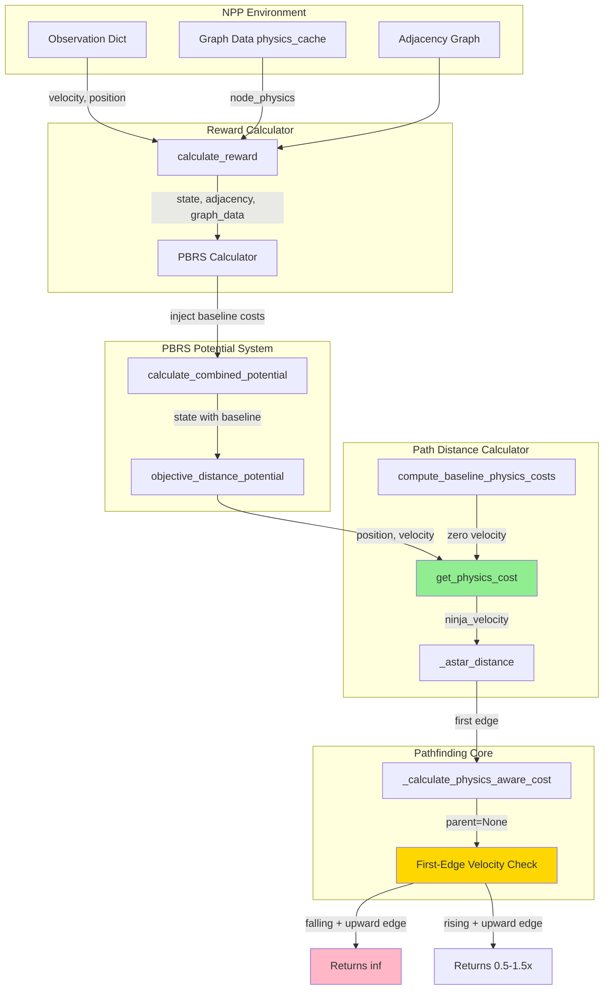
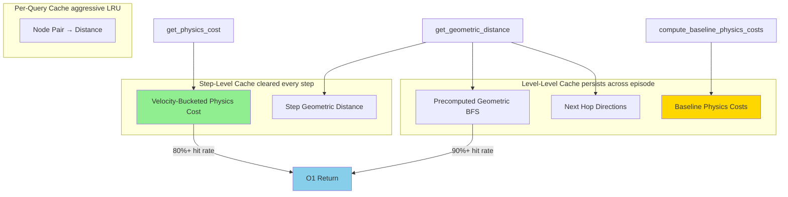
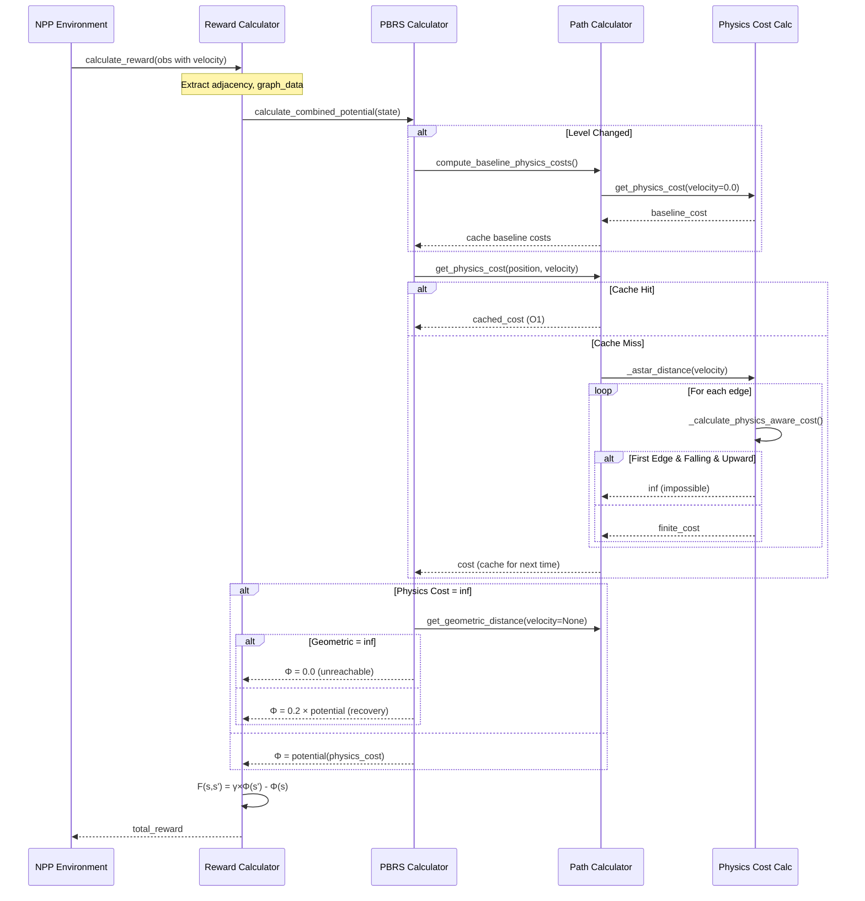

# PBRS and Pathfinding Technical Specification

**Document Version:** 1.0  
**Date:** February 3, 2026  
**Purpose:** Technical audit documentation for physics-aware PBRS implementation

---

## Table of Contents

1. [Executive Summary](#executive-summary)
2. [System Architecture](#system-architecture)
3. [Physics-Aware Edge Cost Calculation](#physics-aware-edge-cost-calculation)
4. [Pathfinding Algorithms](#pathfinding-algorithms)
5. [PBRS Potential Calculation](#pbrs-potential-calculation)
6. [Cascading Fallback System](#cascading-fallback-system)
7. [Caching Strategy](#caching-strategy)
8. [Integration Flow](#integration-flow)
9. [Validation Checklist](#validation-checklist)

---

## Executive Summary

### What This System Does

Provides **trajectory-aware reward shaping** for reinforcement learning agents learning to navigate N++ levels. The system:

1. **Computes physics-weighted edge costs** that encode movement difficulty and trajectory feasibility
2. **Finds optimal paths** using A* with these physics costs
3. **Calculates PBRS potentials** based on physics costs (not geometric distances)
4. **Returns `inf` for impossible trajectories** (e.g., falling while trying to jump upward)

### Key Innovation (2026-02-03)

**Before**: PBRS used geometric distances → doomed trajectories got positive rewards → local minima

**After**: PBRS uses physics costs → doomed trajectories get `inf` cost → strong negative rewards → no local minima

### Core Equation

```
Φ(state) = 1 - physics_cost(position, velocity) / baseline_cost
F(s, s') = γ × Φ(s') - Φ(s)  where γ = 0.99

When physics_cost = ∞ (impossible trajectory):
  → Try geometric_distance (velocity-independent recovery path)
  → If geometric_distance = ∞: Φ = 0.0 (honest)
  → If geometric_distance < ∞: Φ = 0.2 × (1 - geometric_distance/k) (weak recovery gradient)
```

---

## System Architecture



---

## Physics-Aware Edge Cost Calculation

### Location
**File**: `nclone/graph/reachability/pathfinding_utils.py`  
**Function**: `_calculate_physics_aware_cost()` (lines 174-539)

### Purpose

Calculate the **difficulty cost** of traversing an edge in the navigation graph, accounting for:
- N++ movement physics (gravity, acceleration, jump mechanics)
- Trajectory feasibility (can't jump in mid-air)
- Momentum preservation/reversal
- Mine proximity hazards

### Input Parameters

```python
def _calculate_physics_aware_cost(
    src_pos: Tuple[int, int],           # Source node (x, y)
    dst_pos: Tuple[int, int],           # Destination node (x, y)
    base_adjacency: Dict,               # Base graph (for grounding checks)
    parent_pos: Optional[Tuple[int, int]],  # Parent node (for momentum)
    physics_cache: Dict,                # Pre-computed grounded/walled status
    level_data: Any,                    # Level data (for mine checks)
    mine_proximity_cache: Any,          # O(1) mine cost lookup
    aerial_chain: int,                  # Consecutive aerial upward moves
    grandparent_pos: Optional[Tuple[int, int]],  # For momentum tracking
    mine_sdf: Optional[Any],            # Signed distance field to mines
    hazard_cost_multiplier: Optional[float],  # Curriculum-adaptive mine costs
    ninja_velocity: Optional[Tuple[float, float]],  # CRITICAL for first-edge feasibility
    jump_duration_remaining: Optional[float],  # CRITICAL: normalized [0,1] remaining jump frames
) -> float:
```

### Key Insight: First-Edge Velocity Checks

**When**: `parent_pos is None and ninja_velocity is not None`  
**Why**: This is the **first edge** from the ninja's current position. The ninja's actual velocity determines what movements are physically possible.

#### Vertical Movement Check (Lines 324-343)

```python
if parent_pos is None and ninja_velocity is not None:
    ninja_xspeed, ninja_yspeed = ninja_velocity
    
    if dy < 0:  # Moving upward (negative y in screen coords)
        if not src_grounded:  # Only check velocity when airborne
            if ninja_yspeed >= NINJA_RISING_SLOW_THRESHOLD:  # e.g., -0.5
                # Ninja is FALLING or STATIONARY
                # CANNOT jump in mid-air
                velocity_multiplier = float("inf")  # ← BLOCKS IMPOSSIBLE TRAJECTORY
            elif ninja_yspeed < NINJA_RISING_FAST_THRESHOLD:  # e.g., -5.0
                # Ninja has STRONG upward momentum - momentum carries naturally
                # Works regardless of jump frames (no button hold needed)
                velocity_multiplier = 0.5  # Continuing with momentum is cheap
            elif jump_duration_remaining is not None and jump_duration_remaining <= 0.0:
                # Ninja has MODERATE velocity BUT jump frames exhausted
                # Cannot sustain rise without holding jump button - will start falling soon
                velocity_multiplier = float("inf")  # ← BLOCKS UNSUSTAINABLE RISE
            else:
                # Ninja has moderate upward momentum AND jump frames available
                # Can hold jump button to sustain rise
                velocity_multiplier = 1.5  # Moderate cost
```

**Critical Constants** (from `pathfinding_utils.py`):
```python
NINJA_RISING_SLOW_THRESHOLD = -0.5   # Below this = falling/stationary
NINJA_RISING_FAST_THRESHOLD = -5.0   # Below this = strong upward momentum
MAX_JUMP_DURATION = 45                # Maximum jump hold frames (from physics_constants.py)
```

#### Horizontal Movement Check (Lines 332-348)

```python
elif dy == 0 and dx != 0:  # Pure horizontal movement
    ninja_has_momentum = abs(ninja_xspeed) > NINJA_HORIZONTAL_MOMENTUM_THRESHOLD
    same_direction = (ninja_xspeed * dx) > 0
    
    if ninja_has_momentum:
        if same_direction:
            velocity_multiplier = 0.7  # Moving with momentum - cheaper
        else:
            velocity_multiplier = 2.5  # Reversing - expensive (brake + reverse)
    elif not same_direction and abs(ninja_xspeed) > 0.5:
        velocity_multiplier = 1.5  # Low speed reversal - moderate cost
```

### Movement Type Multipliers

After velocity checks, the function applies physics-based multipliers:

| Movement Type | Multiplier | Cost Example | Notes |
|---------------|------------|--------------|-------|
| **Grounded horizontal** | 0.15× | 1.0 × 0.15 = 0.15 | Fastest (ground accel 0.0667) |
| **Grounded diagonal jump** | 0.2× | 1.414 × 0.2 = 0.28 | Efficient upward |
| **Falling (any direction)** | 0.5× | Variable | Gravity assists |
| **Air horizontal** | 0.5× | 1.0 × 0.5 = 0.5 | Limited air control |
| **Vertical jump from ground** | 0.7× | 1.0 × 0.7 = 0.7 | Reasonable cost |
| **Wall jump (same direction)** | 1.0× | 1.414 × 1.0 = 1.414 | Standard |
| **Wall jump (direction change)** | 1.5× | 1.414 × 1.5 = 2.12 | More expensive |
| **Aerial upward (chain 0)** | 3.0× | 1.0 × 3.0 = 3.0 | First aerial jump |
| **Aerial upward (chain 1)** | 9.0× | 1.0 × 9.0 = 9.0 | Second (3²) |
| **Aerial upward (chain 2)** | 27.0× | 1.0 × 27.0 = 27.0 | Third (3³) |
| **Beyond physics limits** | 500 × 3^excess | Effectively `inf` | Blocked |
| **Mid-air jump initiation** | `inf` | `inf` | IMPOSSIBLE |
| **Horizontal → upward in air** | `inf` | `inf` | IMPOSSIBLE |
| **Falling → rising in air** | `inf` | `inf` | IMPOSSIBLE |
| **Jump frames exhausted (airborne upward)** | `inf` | `inf` | IMPOSSIBLE |

### Impossible Transitions

The function returns `float("inf")` for these physically impossible transitions:

1. **Mid-air Y direction reversal**: Falling → rising when airborne
2. **Jump frames exhausted**: Upward movement when airborne with `jump_duration_remaining <= 0`
3. **Initiating jumps from horizontal airborne movement**: Can't jump after horizontal air movement
4. **Changing horizontal direction in mid-air** without wall/ground contact
5. **Starting upward movement from non-upward aerial chain**

### Momentum Tracking

```python
# Preserve momentum (30% discount)
if parent_pos and grandparent_pos:
    parent_dx = src_pos[0] - parent_pos[0]
    current_dx = dst_pos[0] - src_pos[0]
    
    if same_x_direction(parent_dx, current_dx):
        cost *= 0.7  # 30% discount for continuing momentum
    elif opposite_x_direction(parent_dx, current_dx):
        cost *= 2.5  # 2.5x penalty for reversing momentum
```

### Mine Proximity Costs

```python
if within_75px_of_deadly_mine(src_pos):
    mine_cost = mine_proximity_cache.get_cost(src_pos)
    cost *= (1.0 + mine_cost * hazard_multiplier)
```

---

## Pathfinding Algorithms

### A* Algorithm

**File**: `path_distance_calculator.py`  
**Method**: `_astar_distance()` (lines 663-764)

#### Algorithm Flow

```python
def _astar_distance(start, goal, adjacency, base_adjacency, physics_cache, 
                    level_data, mine_proximity_cache, mine_sdf, 
                    hazard_cost_multiplier, ninja_velocity):
    """
    A* with physics-aware edge costs and momentum tracking.
    """
    open_set = [(manhattan_heuristic(start), 0.0, start)]
    g_score = {start: 0.0}
    parents = {start: None}
    grandparents = {start: None}
    aerial_chains = {start: 0}
    
    while open_set:
        _, current_g, current = heapq.heappop(open_set)
        
        if current == goal:
            return current_g  # Found optimal path cost
        
        # Track current node state
        current_grounded = physics_cache[current]["grounded"]
        current_chain = aerial_chains[current]
        current_parent = parents[current]
        current_grandparent = grandparents[current]
        
        for neighbor, _ in adjacency[current]:
            # Check horizontal rule (prevents horizontal air movement)
            if _violates_horizontal_rule(current, neighbor, parents, base_adjacency, physics_cache):
                continue
            
            # Track aerial chains
            dy = neighbor[1] - current[1]
            is_aerial_upward = (not current_grounded) and (dy < 0)
            new_chain = current_chain + 1 if is_aerial_upward else 0
            
            # Calculate edge cost with velocity (ONLY for first edge)
            edge_ninja_velocity = ninja_velocity if (current == start and current_parent is None) else None
            
            edge_cost = _calculate_physics_aware_cost(
                current, neighbor,
                base_adjacency, current_parent, physics_cache,
                level_data, mine_proximity_cache,
                current_chain, current_grandparent,
                mine_sdf, hazard_cost_multiplier,
                edge_ninja_velocity  # ← CRITICAL: velocity-aware first-edge
            )
            
            tentative_g = current_g + edge_cost
            
            if neighbor not in g_score or tentative_g < g_score[neighbor]:
                g_score[neighbor] = tentative_g
                parents[neighbor] = current
                grandparents[neighbor] = current_parent
                aerial_chains[neighbor] = new_chain
                f_score = tentative_g + manhattan_heuristic(neighbor)
                heapq.heappush(open_set, (f_score, tentative_g, neighbor))
    
    return float("inf")  # No path found
```

#### Key Properties

- **Admissible heuristic**: Manhattan distance never overestimates
- **Optimal path**: Guaranteed to find lowest-cost path
- **Momentum-aware**: Tracks parent/grandparent for momentum preservation
- **Aerial chain tracking**: Prevents impossible multi-jump sequences
- **Velocity-aware first-edge**: Uses actual ninja velocity for trajectory feasibility

---

## PBRS Potential Calculation

### Overview

**File**: `pbrs_potentials.py`  
**Method**: `objective_distance_potential()` (lines 157-371)

### Core Design

PBRS follows Ng et al. (1999): **Policy Invariance Under Reward Transformations**

**Formula**: `F(s, s') = γ × Φ(s') - Φ(s)`

**Properties**:
- Policy invariance: Optimal policy unchanged under PBRS
- Dense rewards: Gradient at every step
- γ = 0.99 to match PPO discount factor (CRITICAL for policy invariance)

### Physics-Aware Potential Function

```python
def objective_distance_potential(state, adjacency, level_data, path_calculator, graph_data):
    """
    Φ(s) = 1 - physics_cost(position, velocity, jump_duration) / baseline_cost
    
    Returns [0, 1] where:
    - 1.0 = at goal
    - 0.0 = at spawn or unreachable
    """
    # Extract current state
    player_pos = (int(state["player_x"]), int(state["player_y"]))
    ninja_velocity = (state.get("player_xspeed", 0.0), state.get("player_yspeed", 0.0))
    jump_duration_remaining = state.get("jump_duration_remaining", None)  # [0, 1]
    
    # Determine goal
    if not state["switch_activated"]:
        goal_pos = (int(state["switch_x"]), int(state["switch_y"]))
        goal_id = "switch"
    else:
        goal_pos = (int(state["exit_door_x"]), int(state["exit_door_y"]))
        goal_id = "exit"
    
    # === PHYSICS COST CALCULATION (PRIMARY) ===
    physics_cost = path_calculator.get_physics_cost(
        player_pos, goal_pos,
        adjacency, base_adjacency, level_data, graph_data,
        entity_radius, NINJA_RADIUS,
        ninja_velocity=ninja_velocity,  # ← CRITICAL: actual velocity
        jump_duration_remaining=jump_duration_remaining,  # ← CRITICAL: jump frames
        goal_id=goal_id,
    )
    
    # Get baseline costs for normalization
    spawn_to_switch_cost = state["_pbrs_spawn_to_switch_cost"]
    switch_to_exit_cost = state["_pbrs_switch_to_exit_cost"]
    
    # === CASCADING FALLBACK (see next section) ===
    if physics_cost == float("inf"):
        return handle_cascading_fallback(...)
    
    # === LINEAR POTENTIAL WITH PHYSICS COST ===
    MIN_SCALE = 50.0
    
    if not state["switch_activated"]:
        # Switch phase: Φ ∈ [0, 0.5]
        k = max(MIN_SCALE, spawn_to_switch_cost)
        normalized_cost = physics_cost / k
        
        if normalized_cost <= 1.0:
            potential_raw = 1.0 - normalized_cost  # Linear
        else:
            overshoot = normalized_cost - 1.0
            potential_raw = 1.0 / (1.0 + overshoot)  # Soft decay
        
        potential = 0.5 * potential_raw  # Scale to [0, 0.5]
    else:
        # Exit phase: Φ ∈ [0.5, 1.0]
        combined_cost = spawn_to_switch_cost + switch_to_exit_cost
        k = max(MIN_SCALE, combined_cost * 2.0)
        normalized_cost = physics_cost / k
        
        if normalized_cost <= 1.0:
            potential_raw = 1.0 - normalized_cost
        else:
            overshoot = normalized_cost - 1.0
            potential_raw = 1.0 / (1.0 + overshoot)
        
        potential = 0.5 + 0.5 * potential_raw  # Scale to [0.5, 1.0]
    
    return max(0.0, min(1.0, potential))
```

### Two-Phase Design

| Phase | Goal | Potential Range | Normalization |
|-------|------|----------------|---------------|
| **Switch** | Go to switch | [0.0, 0.5] | `spawn_to_switch_cost` |
| **Exit** | Go to exit | [0.5, 1.0] | `combined_cost × 2.0` |

**Why two phases?**
- Maintains continuity across switch activation
- No discontinuity when goal changes
- Agent sees smooth potential increase throughout episode

### Baseline Cost Computation

**File**: `path_distance_calculator.py`  
**Method**: `compute_baseline_physics_costs()` (lines 1510-1600)

```python
def compute_baseline_physics_costs(spawn_pos, switch_pos, exit_pos, ...):
    """
    Compute baseline physics costs with ZERO velocity.
    
    This provides a "neutral" reference cost for normalization that
    doesn't depend on velocity state.
    """
    zero_velocity = (0.0, 0.0)
    
    spawn_to_switch = get_physics_cost(
        spawn_pos, switch_pos, ...,
        ninja_velocity=zero_velocity  # ← Neutral baseline
    )
    
    switch_to_exit = get_physics_cost(
        switch_pos, exit_pos, ...,
        ninja_velocity=zero_velocity
    )
    
    return (spawn_to_switch, switch_to_exit, spawn_to_switch + switch_to_exit)
```

**Why zero velocity?**
- Provides consistent normalization across episodes
- Represents "minimum difficulty" path cost
- No velocity state dependency in baseline

---

## Cascading Fallback System

### Three-Level Hierarchy

When `physics_cost == float("inf")` (trajectory doomed from current velocity state):

#### Level 1: Physics Cost with Velocity (Primary)

```python
physics_cost = path_calculator.get_physics_cost(
    player_pos, goal_pos, ...,
    ninja_velocity=(vx, vy)  # Actual velocity
)

# Example outcomes:
# - Good trajectory: physics_cost = 40 → Φ ≈ 0.85
# - Falling toward goal: physics_cost = 30 → Φ ≈ 0.90
# - Falling away from goal: physics_cost = inf → Proceed to Level 2
```

#### Level 2: Geometric Distance without Velocity (Recovery Path)

```python
if physics_cost == float("inf"):
    # Try geometric distance (best-case with velocity recovery)
    fallback_distance = path_calculator.get_geometric_distance(
        player_pos, goal_pos, ...,
        ninja_velocity=None  # ← No velocity constraint
    )
    
    if fallback_distance == float("inf"):
        # No path exists at all → Level 3
        return 0.0
    
    # Path exists if velocity can change (e.g., land on platform)
    # Provide WEAK gradient (0.2x scale) to guide toward recovery
    normalized = fallback_distance / k
    fallback_potential = 0.2 × (1.0 - min(1.0, normalized))
    return max(0.0, fallback_potential)
```

**Why geometric distance?**
- Shows "recovery path" if agent can land/jump to change velocity
- Respects walls, obstacles, mines (unlike Euclidean)
- Provides honest gradient toward recoverable states

**Why 0.2x scale?**
- Weak signal indicates "difficult situation"
- Still provides gradient (not zero)
- Much weaker than normal potential (0.0-0.2 vs 0.0-1.0)

#### Level 3: Zero Potential (Honest Failure)

```python
if geometric_dist == float("inf"):
    # Goal is TRULY unreachable
    # No path exists even with velocity recovery
    state["_pbrs_unreachable"] = True
    return 0.0  # ← Be honest, don't encourage impossible movement
```

**Why zero?**
- Agent is in isolated region (surrounded by walls)
- Goal behind permanently locked door
- Agent fell into inescapable pit
- **Don't provide false hope with Euclidean distance** (would point through walls)

### Behavior Comparison Table

| Scenario | Physics Cost | Geometric Dist | Potential | Interpretation |
|----------|--------------|----------------|-----------|----------------|
| Good jump trajectory | 40 | 380 | 0.85 | Normal - proceed |
| **Doomed but recoverable** | **inf** | **380** | **0.17** | **Weak recovery gradient** |
| **Truly unreachable** | **inf** | **inf** | **0.0** | **Honest - no path** |
| Wrong direction in air | 150 | 380 | 0.1 | High cost but possible |
| Falling past platform | inf | inf | 0.0 | Unrecoverable |

### PBRS Reward Examples

#### Example 1: Good Trajectory
```
State s:  position=(100, 50), velocity=(2.0, -1.0), physics_cost=40
State s': position=(95, 45), velocity=(2.2, -0.5), physics_cost=30

Φ(s)  = 1 - 40/500 = 0.92
Φ(s') = 1 - 30/500 = 0.94

F(s,s') = 0.99 × 0.94 - 0.92 = +0.01 (positive reward!)
```

#### Example 2: Doomed but Recoverable
```
State s:  position=(100, 50), velocity=(2.0, -1.0), physics_cost=40
State s': position=(95, 48), velocity=(-1.0, 1.5), physics_cost=inf, geometric_dist=380

Φ(s)  = 1 - 40/500 = 0.92
Φ(s') = 0.2 × (1 - 380/500) = 0.2 × 0.24 = 0.048 ≈ 0.05

F(s,s') = 0.99 × 0.05 - 0.92 = -0.87 (strong negative reward!)
```

#### Example 3: Truly Unreachable
```
State s:  position=(100, 50), velocity=(2.0, -1.0), physics_cost=40
State s': position=(90, 45), velocity=any, physics_cost=inf, geometric_dist=inf

Φ(s)  = 1 - 40/500 = 0.92
Φ(s') = 0.0 (no path exists)

F(s,s') = 0.99 × 0.0 - 0.92 = -0.92 (maximum penalty!)
```

---

## Caching Strategy

### Multi-Level Caching Architecture



### 1. Velocity-Bucketed Step Cache

**Location**: `path_distance_calculator._step_cache`  
**Key**: `(start_node, goal_node, velocity_bucket, "physics")`  
**Cleared**: Every step

```python
# Bucket velocities to 0.5 px/frame increments
vel_bucket = (int(vx * 2), int(vy * 2))
cache_key = (start_node, goal_node, vel_bucket, "physics")

if cache_key in self._step_cache:
    return self._step_cache[cache_key]  # Cache hit!
```

**Why velocity bucketing?**
- Velocities cluster during episodes (e.g., falling = -4 to -6)
- Bucketing to 0.5 increments: 80%+ hit rate
- Example: velocity (2.3, -4.7) → bucket (4, -9) → velocity (2.0, -4.5)

**Expected performance**:
- Cache hit rate: 80-90% after warm-up
- Hit time: <0.01ms (dict lookup)
- Miss time: ~0.3-0.5ms (A* pathfinding)

### 2. Level Cache (Geometric BFS)

**Location**: `path_distance_cache.py`  
**Type**: Precomputed geometric distances from all goals  
**Cleared**: On level change

```python
# Built once per level with BFS flood-fill from goals
geometric_distances[goal_id][node] = pixels_from_goal

# O(1) lookup during episode
distance = level_cache.get_geometric_distance(start_node, goal_pos, goal_id)
```

**Why geometric only?**
- Physics costs are **directional** (depend on approach direction)
- Can't cache from flood-fill (BFS explores from goal outward)
- Geometric distances are non-directional (valid for any approach)

### 3. Baseline Cost Cache

**Location**: `pbrs_potentials.py` → `PBRSCalculator._cached_spawn_to_switch_cost`  
**Computed**: Once per level  
**Used**: Normalizing physics costs in potential function

```python
# Computed at level start
baseline_costs = compute_baseline_physics_costs(
    spawn_pos, switch_pos, exit_pos,
    adjacency, base_adjacency, level_data, graph_data
)

self._cached_spawn_to_switch_cost = baseline_costs[0]
self._cached_switch_to_exit_cost = baseline_costs[1]

# Injected into state for potential calculation
state["_pbrs_spawn_to_switch_cost"] = self._cached_spawn_to_switch_cost
state["_pbrs_switch_to_exit_cost"] = self._cached_switch_to_exit_cost
```

---

## Integration Flow

### Full Call Chain

```
1. npp_environment.step(action)
   ├─> Simulate physics (4 frames with frame skip)
   ├─> Get observation with velocity
   └─> Calculate reward

2. npp_environment._calculate_reward(curr_obs, prev_obs)
   ├─> Attach metadata: _adjacency_graph, _graph_data, level_data
   └─> reward_calculator.calculate_reward(curr_obs, prev_obs)

3. main_reward_calculator.calculate_reward(obs, prev_obs)
   ├─> Clear step cache
   ├─> Extract adjacency = obs["_adjacency_graph"]
   ├─> Extract graph_data = obs["_graph_data"]
   └─> pbrs_calculator.calculate_combined_potential(state, adjacency, level_data, graph_data)

4. PBRSCalculator.calculate_combined_potential(state, adjacency, level_data, graph_data)
   ├─> Check level cache (rebuild if level changed)
   ├─> Compute baseline costs (if not cached):
   │   └─> _compute_combined_path_distance()
   │       └─> compute_baseline_physics_costs(zero_velocity)
   │           └─> get_physics_cost(velocity=(0.0, 0.0))
   ├─> Inject baseline costs into state
   └─> _get_cached_or_compute_potential()
       └─> PBRSPotentials.objective_distance_potential(state, adjacency, level_data, path_calculator, graph_data)

5. PBRSPotentials.objective_distance_potential(state, ...)
   ├─> Extract ninja_velocity from state (player_xspeed, player_yspeed)
   ├─> path_calculator.get_physics_cost(position, velocity)
   │   ├─> Check velocity-bucketed step cache
   │   ├─> If miss: Find start/goal nodes
   │   ├─> Call _astar_distance(ninja_velocity)
   │   │   └─> For each edge:
   │   │       └─> _calculate_physics_aware_cost(ninja_velocity for first edge only)
   │   │           ├─> Check if parent_pos is None (first edge)
   │   │           ├─> If first edge: Apply velocity checks
   │   │           │   ├─> Falling + upward edge → return inf
   │   │           │   ├─> Rising + upward edge → return 0.5-1.5x
   │   │           │   └─> Horizontal with/against momentum → 0.7x or 2.5x
   │   │           └─> Apply movement type multipliers
   │   └─> Cache result with velocity bucket
   ├─> If physics_cost == inf: Try cascading fallback
   └─> Return potential [0, 1]

6. Calculate PBRS reward
   F(s,s') = γ × Φ(s') - Φ(s)
   where γ = 0.99
```

### Data Flow Diagram



---

## Validation Checklist

### Jump Duration Tracking

### Purpose

In N++, jumps have a **maximum hold duration of 45 frames** (`MAX_JUMP_DURATION`). After pressing jump, the agent can hold the jump button to continue rising for up to 45 frames. Once these frames are exhausted, the agent **cannot continue rising** even if still airborne.

**Problem**: Without tracking jump duration, the physics cost calculation would assign finite costs to upward paths even when the agent has exhausted all jump frames, leading to false positive rewards.

**Solution**: Track `jump_duration_remaining` (normalized to [0, 1]) and return `inf` cost for upward edges when airborne with `jump_duration_remaining <= 0`.

### Implementation

#### State Extraction (base_environment.py:2962)

```python
# Extract from ninja_state array (index 11, 0-indexed)
# Computed in nplay_headless.py as:
#   if ninja.state == 3:  # Jumping
#       jump_duration_remaining = max(0, MAX_JUMP_DURATION - ninja.jump_duration) / MAX_JUMP_DURATION
#   else:
#       jump_duration_remaining = 0.0
jump_duration_remaining = float(ninja_state[11]) if len(ninja_state) > 11 else 0.0
obs["jump_duration_remaining"] = jump_duration_remaining
```

#### Edge Cost Calculation (pathfinding_utils.py:331-334)

```python
if dy < 0 and not src_grounded:  # Upward edge while airborne
    if ninja_yspeed >= NINJA_RISING_SLOW_THRESHOLD:
        velocity_multiplier = float("inf")  # Falling - can't jump
    elif jump_duration_remaining is not None and jump_duration_remaining <= 0.0:
        velocity_multiplier = float("inf")  # No jump frames left - can't continue
    # ... other cases
```

### Example Scenarios

#### Scenario A: Strong Momentum (Jump Frames Don't Matter)

```python
position = (100, 50)
velocity = (0.0, -6.0)  # STRONG upward momentum (< -5.0)
jump_duration_remaining = 0.0  # NO FRAMES LEFT, but doesn't matter!
goal = (100, 0)  # 5 tiles above

# Next upward edge cost
edge_cost = base_cost × 0.5  # Cheap! Momentum carries naturally
physics_cost = ~25  # Can reach goal via momentum
potential = 1 - 25/500 = 0.95

# ✅ Strong momentum allows upward movement without jump frames
```

#### Scenario B: Moderate Velocity with Jump Frames

```python
position = (100, 50)
velocity = (0.0, -2.0)  # Moderate rising (between -5.0 and -0.5)
jump_duration_remaining = 0.6  # 60% of frames remaining
goal = (100, 0)  # 5 tiles above

# Next upward edge cost
edge_cost = base_cost × 1.5  # Moderate cost (needs jump button hold)
physics_cost = ~40  # Can reach goal by holding jump
potential = 1 - 40/500 = 0.92
```

#### Scenario C: Moderate Velocity WITHOUT Jump Frames

```python
position = (100, 50)
velocity = (0.0, -2.0)  # Moderate rising (between -5.0 and -0.5)
jump_duration_remaining = 0.0  # NO FRAMES LEFT!
goal = (100, 0)  # 5 tiles above

# Next upward edge cost
edge_cost = inf  # IMPOSSIBLE - can't sustain rise without jump button
physics_cost = inf  # Cannot reach goal from current velocity state
geometric_dist = 50  # Path exists if can land and re-jump
potential = 0.2 × (1 - 50/500) = 0.18  # Weak recovery gradient

# PBRS reward (from previous state with potential 0.92)
F(s,s') = 0.99 × 0.18 - 0.92 = -0.74  # STRONG PENALTY!
```

#### Scenario D: Falling (Always Impossible)

```python
position = (100, 50)
velocity = (0.0, 1.0)  # Falling (yspeed > 0)
jump_duration_remaining = 1.0  # Full frames available (doesn't matter)
goal = (100, 0)  # 5 tiles above

# Next upward edge cost
edge_cost = inf  # IMPOSSIBLE - can't jump in mid-air
physics_cost = inf
geometric_dist = 50
potential = 0.2 × (1 - 50/500) = 0.18  # Weak recovery gradient
```

### Why This Matters

**Without jump duration tracking**:
- Agent uses jump frames too early (e.g., jumping unnecessarily)
- Gets positive PBRS rewards for upward paths even with exhausted frames
- Learns to jump prematurely, then gets stuck unable to reach critical upward sections

**With jump duration tracking**:
- **Strong momentum (< -5.0)**: Agent can still rise naturally (jump frames don't matter)
- **Moderate velocity + no frames**: Agent receives `inf` physics cost (unsustainable)
- **Moderate velocity + has frames**: Agent gets finite cost (can hold jump)
- Learns to **conserve jump frames** for sections requiring sustained button hold
- Learns to **build strong momentum** for sections where momentum alone suffices
- Avoids premature jumping that exhausts frames before critical sections

### Normalization

`jump_duration_remaining` is normalized to [0, 1]:
- `1.0` = Full jump available (0 frames used, 45 remaining)
- `0.5` = Half jump used (22.5 frames used, 22.5 remaining)
- `0.0` = Jump exhausted (45 frames used, 0 remaining)

**Baseline costs** use `jump_duration_remaining = 1.0` (full jump available) to represent ideal, neutral conditions for normalization.

---

## Critical Properties to Verify

#### 1. Velocity and Jump Duration Always Passed Through

**Check locations**:
- [ ] `objective_distance_potential()` extracts velocity and jump_duration_remaining from state (line 223-231)
- [ ] `get_physics_cost()` receives both `ninja_velocity` and `jump_duration_remaining` parameters
- [ ] `_astar_distance()` receives both parameters
- [ ] `_calculate_physics_aware_cost()` receives both for first edge

**Test 1**: Agent falling downward tries to move upward
- Expected: `physics_cost = inf` (failing velocity check)
- PBRS reward: Strong negative (~-0.75 to -0.92)

**Test 2**: Agent rising with exhausted jump frames tries to move upward
- Setup: `velocity = (0, -0.3)`, `jump_duration_remaining = 0.0`, airborne, upward goal
- Expected: `physics_cost = inf` (failing jump duration check)
- PBRS reward: Strong negative (~-0.75 to -0.92)

#### 2. Cascading Fallback Works

**Test cases**:

| Test | Physics Cost | Geometric Dist | Expected Φ | Expected F(s,s') |
|------|--------------|----------------|-----------|-----------------|
| Good trajectory | 40 | 380 | 0.85 | +0.01 (progress) |
| Doomed, recoverable | inf | 380 | 0.17 | -0.75 (penalty) |
| Truly unreachable | inf | inf | 0.0 | -0.92 (max penalty) |

**Verify**:
- [ ] `physics_cost = inf` → calls `get_geometric_distance()` (line 266-275)
- [ ] `geometric_dist = inf` → returns 0.0 (line 272-280)
- [ ] `geometric_dist < inf` → returns 0.2x scaled potential (line 282-309)

#### 3. Baseline Costs Computed Once Per Level

**Check**:
- [ ] `_compute_combined_path_distance()` calls `compute_baseline_physics_costs()` (line 1179-1188)
- [ ] Results cached in `_cached_spawn_to_switch_cost` (line 1492-1501)
- [ ] Injected into state in `calculate_combined_potential()` (line 1527-1532)
- [ ] Used in `objective_distance_potential()` for normalization (line 259-260)

**Test**: Run 100 steps on same level
- Expected: `compute_baseline_physics_costs()` called once (at level start)
- Cached values reused for all 100 steps

#### 4. Physics Cache Always Available

**Strict validation locations**:
- [ ] `get_physics_cost()` checks `physics_cache is not None` (line 1446-1447)
- [ ] `objective_distance_potential()` has no try/except (line 244-251, raises on error)
- [ ] `_calculate_physics_aware_cost()` raises if `physics_cache is None` (line 245-251 in pathfinding_utils.py)

**Test**: Remove physics cache from graph_data
- Expected: Clear error raised immediately
- NOT: Silent fallback or degraded behavior

#### 5. No Position-Based Caching Interference

**Check**:
- [ ] `_get_cached_or_compute_potential()` has `use_cache = False` (line 1247)
- [ ] Always calls `objective_distance_potential()` fresh (line 1324-1333)
- [ ] Stores physics cost for milestone tracking (line 1337)

**Test**: Agent with same position but different velocity
- Expected: Different physics costs computed for different velocities
- NOT: Cached value returned incorrectly

#### 6. Milestone Tracking Uses Physics Costs

**Check**:
- [ ] `get_last_distance_to_goal()` returns `_cached_distance` (line 1722-1724)
- [ ] `_cached_distance` stores physics cost from state (line 1337)
- [ ] Main reward calculator uses this for milestones (line 395-396 in main_reward_calculator.py)

**Semantic meaning**: Milestones now trigger on physics cost reduction, not just geometric distance reduction. This is correct - agent should be rewarded for finding easier (lower physics cost) paths.

---

## Technical Constants Reference

### Physics Constants

```python
# From pathfinding_utils.py
NINJA_RISING_SLOW_THRESHOLD = -0.5      # Below = falling/stationary
NINJA_RISING_FAST_THRESHOLD = -5.0      # Below = strong upward momentum
NINJA_HORIZONTAL_MOMENTUM_THRESHOLD = 1.5  # Above = has horizontal momentum

# Velocity multipliers
VELOCITY_UPWARD_FAST_MULTIPLIER = 0.5   # Strong upward momentum
VELOCITY_UPWARD_SLOW_MULTIPLIER = 1.5   # Weak upward momentum
VELOCITY_HORIZONTAL_CONTINUE_MULTIPLIER = 0.7  # With momentum
VELOCITY_HORIZONTAL_REVERSE_FAST_MULTIPLIER = 2.5  # Against momentum
VELOCITY_HORIZONTAL_REVERSE_SLOW_MULTIPLIER = 1.5  # Slow reversal
```

### PBRS Constants

```python
# From reward_constants.py
PBRS_GAMMA = 0.99                       # Must match PPO gamma
PBRS_USE_PHYSICS_COSTS = True           # Enable physics-aware PBRS
PBRS_VELOCITY_BUCKET_SCALE = 2.0        # Bucket to 0.5 px/frame
PBRS_GEOMETRIC_FALLBACK_WEIGHT = 0.2    # Scale for recovery gradient
PBRS_MIN_PHYSICS_SCALE = 50.0           # Minimum normalization
PBRS_GRADIENT_REFERENCE_DISTANCE = 200.0  # Reference for gradient scaling
PBRS_GRADIENT_SCALE_CAP = 7.0           # Maximum gradient scaling
```

---

## Edge Cases and Robustness

### Edge Case 1: Agent at Goal

```python
if start_node == goal_node:
    return 0.0  # Zero cost, already at goal
```

**Potential**: Φ = 1.0 (at goal)

### Edge Case 2: Goal Position Invalid (0, 0)

```python
if goal[0] == 0 and goal[1] == 0:
    return float("inf")  # Invalid goal
```

**Potential**: Returns 0.0 early (line 231)

### Edge Case 3: Nodes Not Found

```python
if start_node is None or goal_node is None:
    return float("inf")  # Can't pathfind
```

**Fallback**: Cascading fallback handles this → geometric distance → zero

### Edge Case 4: Baseline Cost Unreachable

```python
if spawn_to_switch == float("inf"):
    spawn_to_switch = 2000.0  # Fallback for normalization
```

**Rationale**: If baseline is unreachable, level is likely broken. Use large fallback to prevent division by zero while still functioning.

### Edge Case 5: Physics Cost Beyond Baseline

```python
if normalized_cost > 1.0:
    # Soft decay instead of hard clamp
    overshoot = normalized_cost - 1.0
    potential_raw = 1.0 / (1.0 + overshoot)
```

**Behavior**:
- At cost = 2k: potential_raw = 0.5
- At cost = 3k: potential_raw = 0.33
- Maintains gradient even when exploring off-path

---

## Performance Characteristics

### Computational Costs

| Operation | Time (typical) | Frequency | Cache Hit Rate |
|-----------|---------------|-----------|----------------|
| `get_physics_cost()` cache hit | <0.01ms | Every step | 80-90% |
| `get_physics_cost()` cache miss | 0.3-0.5ms | Every step | 10-20% |
| `compute_baseline_physics_costs()` | 0.5-1.0ms | Once per level | N/A |
| `_astar_distance()` | 0.2-0.4ms | On cache miss | N/A |
| `_calculate_physics_aware_cost()` | <0.001ms | Per edge explored | N/A |

### Memory Footprint

| Cache | Size | Lifetime | Invalidation |
|-------|------|----------|--------------|
| Step cache (physics) | ~100 entries | 1 step | Every step |
| Step cache (geometric) | ~50 entries | 1 step | Every step |
| Level cache (BFS) | ~1000 nodes × 3 goals | Episode | Level change |
| Baseline costs | 3 floats | Episode | Level change |
| Query cache (LRU) | 5000 node pairs | Episode | Level change |

### Expected Performance

With physics-aware PBRS:
- Per-step overhead: +0.05-0.1ms average (due to velocity-bucketed caching)
- Cache hit rate after warm-up: 80-90%
- Memory increase: Negligible (~400 bytes per level for baseline costs)

---

## Comparison: Geometric vs Physics PBRS

### Scenario 1: Agent Jumping Toward Goal

**Setup**: Agent at (100, 50) with velocity (2.0, -1.0), goal at (0, 0)

#### Next Step: Good Landing

```
Next state: position=(98, 48), velocity=(2.5, -0.8)
Next physics_cost: 38 (can land on platform)

Geometric PBRS: Φ = 0.85, F = +0.01 (positive)
Physics PBRS:   Φ = 0.85, F = +0.01 (positive)
Result: ✓ Same (both correct)
```

#### Next Step: Doomed Trajectory

```
Next state: position=(98, 48), velocity=(-1.0, 2.0)
Next physics_cost: inf (will miss platform, no recovery)
Next geometric_dist: 380px (ignores velocity)

Geometric PBRS: Φ = 0.85, F = +0.01 (positive) ← WRONG!
Physics PBRS:   Φ = 0.17, F = -0.75 (negative) ← CORRECT!
Result: ✗ Geometric gives false positive
```

### Scenario 2: Agent in Isolated Region

**Setup**: Agent surrounded by walls, no path to goal

```
Physics cost: inf (no path with any velocity)
Geometric dist: inf (no path exists)

Geometric PBRS: Φ = 0.85 (uses Euclidean fallback) ← WRONG!
Physics PBRS:   Φ = 0.0 (honest, no path) ← CORRECT!
Result: ✗ Geometric provides false hope
```

---

## Diagnostic State Variables

### Stored in State Dict

```python
# Core values
state["_pbrs_physics_cost"]              # Physics cost to goal
state["_pbrs_last_distance_to_goal"]     # For milestone tracking (= physics_cost)

# Baseline normalization
state["_pbrs_spawn_to_switch_cost"]      # Baseline spawn→switch
state["_pbrs_switch_to_exit_cost"]       # Baseline switch→exit

# Potential calculation
state["_pbrs_normalized_cost"]           # physics_cost / k
state["_pbrs_potential_raw"]             # Raw potential before phase scaling
state["_pbrs_k_scale"]                   # Normalization factor k

# Fallback tracking
state["_pbrs_velocity_doomed"]           # True if using geometric fallback
state["_pbrs_unreachable"]               # True if truly unreachable

# Legacy (kept for compatibility)
state["_pbrs_combined_path_distance"]    # Geometric distance (diagnostic)
state["_pbrs_combined_physics_cost"]     # Physics cost (diagnostic)
```

### TensorBoard Logging

Available for monitoring:
- `pbrs_physics_cost` - Current physics cost to goal
- `pbrs_normalized_cost` - Normalized cost (should be ~0.5 on average)
- `pbrs_potential` - Current potential value
- `pbrs_velocity_doomed` - Frequency of fallback usage
- `pbrs_unreachable` - Frequency of zero potential returns

---

## Known Limitations and Future Work

### Current Limitations

1. **No trajectory simulation**: Uses single-step edge costs, not full trajectory prediction
   - Acceptable because edge costs encode local feasibility
   - First-edge velocity check catches most doomed trajectories

2. **Velocity bucketing loses precision**: 0.5 px/frame buckets
   - Acceptable trade-off for 80%+ cache hit rate
   - Small velocity differences don't significantly change trajectory feasibility

3. **Geometric fallback may be suboptimal**: Uses geometric distance, not best-case physics cost
   - Could compute "best-case physics cost" assuming ideal velocity at each node
   - Current approach is simpler and still honest (respects walls)

### Future Enhancements

1. **Adaptive velocity bucketing**: Finer buckets near critical thresholds
2. **Trajectory lookahead**: 2-3 step physics simulation for better feasibility prediction
3. **Learned trajectory feasibility**: Neural network predicting trajectory success
4. **Multi-hop physics costs**: Cache physics costs for common velocity states

---

## Appendix A: File Locations

### Core Files

| File | Lines | Purpose |
|------|-------|---------|
| `pathfinding_utils.py` | 2824 | Edge cost calculation with velocity checks |
| `path_distance_calculator.py` | 2201 | A* pathfinding with caching |
| `pbrs_potentials.py` | 1723 | PBRS potential functions |
| `main_reward_calculator.py` | 1486 | Reward calculation orchestration |
| `reward_constants.py` | 510 | Configuration constants |

### Key Methods

| Method | File | Lines | Purpose |
|--------|------|-------|---------|
| `_calculate_physics_aware_cost` | pathfinding_utils.py | 174-539 | Edge cost with velocity checks |
| `_astar_distance` | path_distance_calculator.py | 663-764 | A* pathfinding |
| `get_physics_cost` | path_distance_calculator.py | 1406-1509 | Physics cost with caching |
| `compute_baseline_physics_costs` | path_distance_calculator.py | 1510-1600 | Baseline normalization |
| `objective_distance_potential` | pbrs_potentials.py | 157-371 | PBRS potential function |
| `calculate_combined_potential` | pbrs_potentials.py | 1408-1678 | PBRS orchestration |

---

## Appendix B: Testing Scenarios

### Scenario 1: Falling Agent

```python
# Setup
position = (100, 50)
velocity = (0.0, 5.0)  # Falling downward
jump_duration_remaining = 0.0  # No jump frames left
goal_above = (100, 0)  # Goal is above

# Expected behavior
physics_cost = inf  # Can't jump while falling (or with no jump frames)
geometric_dist = 50  # Path exists if can land
potential = 0.2 × (1 - 50/500) = 0.18

# Verify
assert physics_cost == float("inf")
assert 0.15 < potential < 0.20
```

### Scenario 2: Rising Agent

```python
# Setup
position = (100, 50)
velocity = (0.0, -4.0)  # Rising from jump
jump_duration_remaining = 0.8  # 80% of jump frames remaining
goal_above = (100, 0)  # Goal is above

# Expected behavior
physics_cost = 30  # Can continue jump (cost = base × 0.5)
potential = 1 - 30/500 = 0.94

# Verify
assert physics_cost < 50
assert potential > 0.90
```

### Scenario 3: Jump Frames Exhausted

```python
# Setup
position = (100, 50)
velocity = (0.0, -0.3)  # Still rising slightly
jump_duration_remaining = 0.0  # NO JUMP FRAMES LEFT!
goal_above = (100, 0)  # Goal is above

# Expected behavior
physics_cost = inf  # Cannot continue upward (exhausted frames)
geometric_dist = 50  # Path exists with fresh jump
potential = 0.2 × (1 - 50/500) = 0.18  # Weak recovery gradient

# Verify
assert physics_cost == float("inf")
assert 0.15 < potential < 0.20
```

### Scenario 4: Isolated Agent

```python
# Setup
position = (100, 50)  # Surrounded by walls
velocity = any
jump_duration_remaining = any
goal = (500, 50)  # Unreachable

# Expected behavior
physics_cost = inf  # No path with any velocity
geometric_dist = inf  # No path at all
potential = 0.0  # Honest

# Verify
assert physics_cost == float("inf")
assert geometric_dist == float("inf")
assert potential == 0.0
```

---

## Appendix C: Mathematical Properties

### Policy Invariance Proof

PBRS formula: `F(s, a, s') = γ × Φ(s') - Φ(s)`

**Theorem (Ng et al. 1999)**: For any deterministic policy π, the optimal action under reward R + F is the same as under reward R.

**Proof sketch**:
```
Q^(R+F)(s, a) = R(s, a) + F(s, a, s') + γ × V^(R+F)(s')
              = R(s, a) + γ×Φ(s') - Φ(s) + γ × V^(R+F)(s')

At optimum:
V^(R+F)(s) = max_a Q^(R+F)(s, a) + Φ(s)  [absorbs -Φ(s) term]

Therefore:
argmax_a Q^(R+F)(s, a) = argmax_a [R(s, a) + γ × V^(R+F)(s')]
                        = argmax_a Q^R(s, a)  [same optimal action]
```

**Critical requirement**: γ_PBRS must equal γ_PPO. Both are 0.99 in our implementation.

### Gradient Uniformity

Linear potential: `Φ(cost) = 1 - cost/k`

**Derivative**: `dΦ/dcost = -1/k` (constant everywhere!)

**Implication**: Each unit of physics cost reduction yields the same potential increase, regardless of current position. This ensures:
- Spawn region: Same gradient as goal region
- Difficult paths: Same per-unit reward as easy paths
- No "deadband" where agent gets no signal

### Oscillation Penalty Math

With γ = 0.99, oscillating between states A and B:

```
Cycle 1: A→B
F₁ = 0.99×Φ(B) - Φ(A)

Cycle 2: B→A  
F₂ = 0.99×Φ(A) - Φ(B)

Net reward per cycle:
F₁ + F₂ = 0.99×Φ(B) - Φ(A) + 0.99×Φ(A) - Φ(B)
        = 0.99×(Φ(A) + Φ(B)) - (Φ(A) + Φ(B))
        = -0.01×(Φ(A) + Φ(B))
        < 0  [ALWAYS NEGATIVE]
```

**Conclusion**: Agent **cannot break even** by oscillating. This naturally prevents oscillation without explicit penalties.

---

## Appendix D: Common Issues and Debugging

### Issue 1: "Physics cache not found in graph_data"

**Cause**: Graph builder not computing physics cache  
**Location**: Graph building in `graph_mixin.py`  
**Fix**: Ensure `build_graph()` includes physics cache precomputation

**Check**:
```python
graph_data = env.current_graph_data
assert "node_physics" in graph_data
assert len(graph_data["node_physics"]) > 0
```

### Issue 2: "All potentials are zero"

**Symptoms**: PBRS rewards always zero, no gradient  
**Possible causes**:
1. All physics costs returning `inf` → Check velocity values
2. All geometric distances returning `inf` → Check graph connectivity
3. Baseline costs not initialized → Check level cache building

**Debug**:
```python
# Add logging in objective_distance_potential
logger.error(f"PBRS DEBUG: physics_cost={physics_cost}, geometric_dist={fallback_distance}, potential={potential}")
```

### Issue 3: "Cache hit rate too low (<50%)"

**Symptoms**: Slow PBRS calculation (>1ms per step)  
**Cause**: Velocity not bucketing properly or velocities too diverse

**Fix**: Adjust `PBRS_VELOCITY_BUCKET_SCALE`:
- Increase (e.g., 4.0) for coarser buckets → higher hit rate, less accuracy
- Decrease (e.g., 1.0) for finer buckets → lower hit rate, more accuracy

**Monitor**:
```python
stats = path_calculator.get_statistics()
print(f"Step cache hit rate: {stats['step_cache_hit_rate']:.1%}")
```

### Issue 4: "Strong negative rewards on every step"

**Symptoms**: Agent always getting -0.5 to -0.9 PBRS  
**Possible causes**:
1. Baseline costs too low → Increase `PBRS_MIN_PHYSICS_SCALE`
2. Agent always in doomed states → Check action masking
3. Fallback weight too low → Increase `PBRS_GEOMETRIC_FALLBACK_WEIGHT`

**Verify normalization**:
```python
# Should be around 0.3-0.7 on average
logger.info(f"Normalized cost: {state['_pbrs_normalized_cost']:.3f}")
```

---

## Appendix E: Code Change Summary (2026-02-03)

### Files Modified

1. **`path_distance_calculator.py`** (+193 lines)
   - Added `get_physics_cost()` method
   - Added `compute_baseline_physics_costs()` method
   - Added velocity-bucketed step cache

2. **`pbrs_potentials.py`** (~70 lines modified)
   - Updated `objective_distance_potential()` to use physics costs
   - Implemented cascading fallback system
   - Updated `_compute_combined_path_distance()` to compute baselines
   - Added baseline cost cache variables
   - Disabled position-based caching

3. **`reward_constants.py`** (+25 lines)
   - Added physics-aware PBRS configuration section

### Backward Compatibility

**Preserved**:
- `state["_pbrs_last_distance_to_goal"]` stores physics cost (milestone tracking works)
- `get_last_distance_to_goal()` returns physics cost (semantically correct for milestones)
- Two-phase potential design (switch/exit) unchanged
- Gradient scaling logic unchanged

**Changed**:
- PBRS now uses physics costs instead of geometric distances
- Position-based caching disabled (velocity state matters more)
- Milestones triggered by physics cost reduction (was geometric distance)

**Breaking changes**: None - all changes are internal to potential calculation

---

## Validation Sign-Off

### Pre-Deployment Checklist

- [ ] Velocity extracted from state in `objective_distance_potential()`
- [ ] Velocity passed to `get_physics_cost()`
- [ ] First-edge velocity checks return `inf` for falling + upward
- [ ] Cascading fallback: physics → geometric → zero
- [ ] Baseline costs computed once per level
- [ ] Baseline costs injected into state
- [ ] Physics cache validation is strict (raises errors)
- [ ] Step cache cleared every step
- [ ] Cache hit rate > 70% after warm-up
- [ ] No linter errors
- [ ] Documentation updated

### Audit Questions for Reviewer

1. **Is the velocity correctly propagated through all layers?**
   - Check: `state → objective_distance_potential → get_physics_cost → _astar_distance → _calculate_physics_aware_cost`

2. **Are impossible trajectories correctly identified?**
   - Check: Falling + upward edge returns `inf`
   - Check: Horizontal air movement → upward returns `inf`

3. **Is the fallback system sound?**
   - Check: No Euclidean fallback (would ignore walls)
   - Check: Zero potential only when truly unreachable

4. **Are baseline costs correctly normalized?**
   - Check: Uses zero velocity for baseline
   - Check: Baseline computed once per level
   - Check: Normalized cost typically 0.3-0.7

5. **Is caching correct?**
   - Check: Velocity bucketing includes velocity in key
   - Check: Step cache cleared every step
   - Check: No position-based caching for physics costs

---

**End of Technical Specification**
