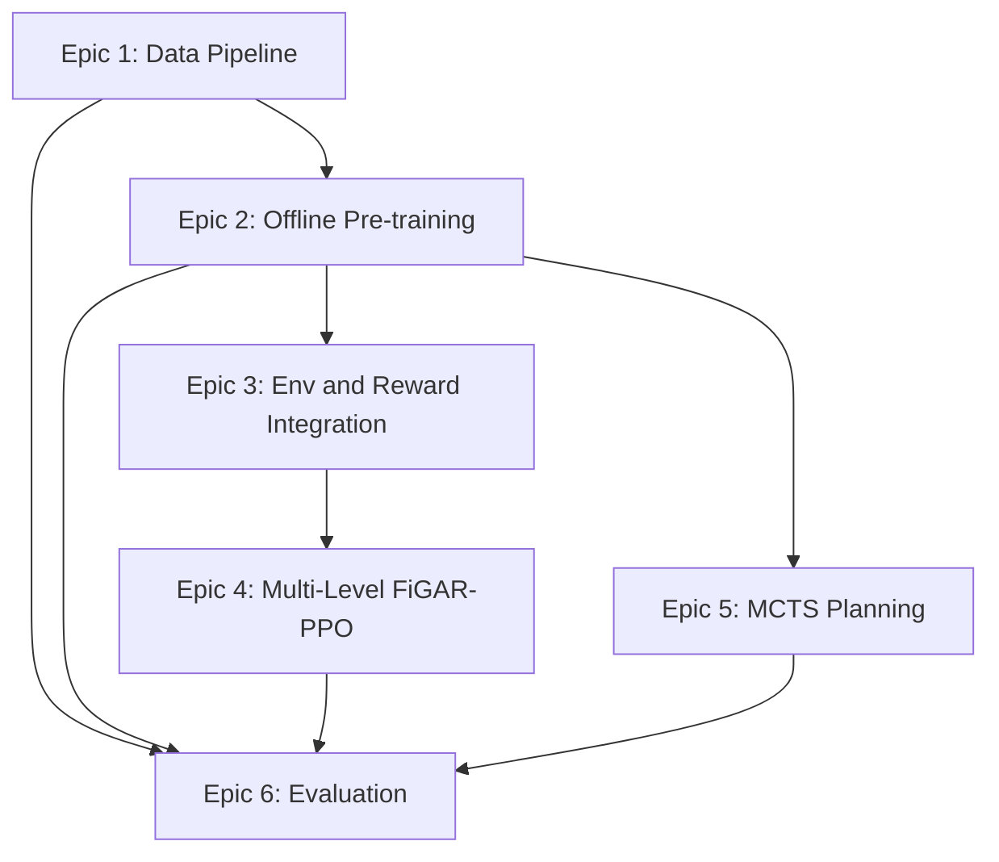

# Generalizable Agent v2 — Master Plan

## First Goal

Prove the end-to-end pipeline on the simplest viable entity set:

- **1 exit door**
- **1 exit switch**
- **Up to 256 static toggle mines** (toggled on / off at spawn)
- **Any tile layout** (42×23 grid, all 38 tile types)

No dynamic entities (drones, death balls, thwumps, bounce blocks, launch pads, etc.) in scope for this goal. Dynamic entities are deliberately excluded to reduce complexity while proving out the full architecture.

---

## Why This Scope

The static-entity scope is not a restriction — it is a proving ground. The 11D ninja state, 24D nearest-8-mine features, and 128D tile encoder already exist and target exactly this entity set. The reward machine, PBRS pipeline, IQL training, and FiGAR-PPO infrastructure are in place. The goal is to validate that the full chain — offline pretraining → universal reward shaping → multi-level online training → test-time MCTS planning — works reliably on a controllable, reproducible entity set before adding dynamic complexity.

Success here demonstrates:
1. A learned V(s) generalizes across arbitrary tile layouts.
2. PBRS from that V(s) guides online RL without level-specific tuning.
3. FiGAR-PPO learns a transferable policy across 200+ levels simultaneously.
4. Test-time MCTS planning lifts policy quality further on held-out levels.

---

## Architecture Overview

The system is a three-phase pipeline:

### Phase 1 — Offline Pre-training (IQL, one-time)

Train Implicit Q-Learning on the filtered attract demo corpus (~250K demos across 500+ levels). Produces:

- **V-network**: cross-level value function V(s, level) used as PBRS potential
- **Q-network**: action-value function
- **Policy prior**: 6-action softmax used to seed MCTS

Architecture:
- Agent encoder: `[x_norm, y_norm, vx_norm, vy_norm, on_ground, wall_sliding, jump_frames, switch_collected, floor_nx, floor_ny, wall_n]` (11D) + 8 nearest mines × 3 features (24D) → 256D MLP
- Tile encoder: 42×23 tile grid + switch overlay + exit overlay → 18-channel input → 3 conv layers → global average pool → 128D
- Combiner: concat(256, 128) → 512D → V/Q/policy heads
- IQL config: expectile τ=0.9, γ=0.99, batch_size=256, lr=3e-4

### Phase 2 — Universal Reward + Online Multi-Level FiGAR-PPO

Replace level-specific A\* HWM shaping with the frozen IQL V-network as PBRS. Train FiGAR-PPO across many levels simultaneously.

Key components:
- **NeuralValuePBRS**: frozen V-network as potential Φ(s); CNN output cached per level (128D), MLP runs per step (~0.01ms overhead)
- **Reward machine**: 3-state FSM (pre-switch → post-switch → terminal); ensures Φ(terminal) = 0; two-phase shaping: Φ_switch before switch, Φ_exit after
- **Shaping weight annealing**: α: 1.0 → 0.1 over first 60% of training steps
- **FiGAR-PPO**: factored action (6 base) + duration head (13 bins: 1–90 frames); contact-interrupt stops macro-actions on regime change (grounded/airborne/wall-sliding)
- **Level-context encoder**: tile grid CNN injected into PPO feature extractor (new work — PPO currently lacks this)
- **Multi-level scheduler**: assign N parallel environments to M levels; rotate stalled levels; track per-level progress

### Phase 3 — Test-Time MCTS Planning

At inference, run Gumbel AlphaZero tree search using the Rust simulator as a perfect world model. No learned dynamics — physics is exact.

Key components:
- **IQL policy**: 6-action distribution serves as MCTS prior P(a|s)
- **IQL value**: V(s) evaluates leaf nodes without rollout
- **Gumbel-Top-k**: sample k=16 candidate actions per node without replacement; sequential halving allocates simulation budget
- **MPC loop**: plan horizon H=15–25 macro-actions; execute first action; replan from new state
- **Simulator**: `nclone_native.Simulator` (~0.1ms per step); fork state per tree node

---

## Existing Infrastructure

| Component | Status | Location |
|-----------|--------|----------|
| Corpus filter | Exists | `nclone/offline_rl/dataset/filter_attracts.py` |
| Transition extractor | Exists (reward fixed) | `nclone/offline_rl/dataset/transition_extractor.py` |
| HDF5 dataset builder | Exists | `nclone/offline_rl/dataset/build_dataset_cli.py` |
| IQL trainer | Exists (batch_size fixed) | `nclone/offline_rl/algorithms/iql.py` |
| IQL networks | Exists | `nclone/offline_rl/networks/value_networks.py` |
| Tile encoder | Exists | `nclone/offline_rl/networks/tile_encoder.py` |
| V-network export | Exists | `nclone/offline_rl/export.py` |
| NeuralValuePBRS | Exists (cache bug fixed) | `nclone/value_function/neural_value_pbrs.py` |
| TwoPhaseValuePBRS | Exists | `nclone/value_function/two_phase_pbrs.py` |
| Reward machine (3-state FSM) | Exists | `nclone/gym_environment/reward_calculation/reward_machine.py` |
| PBRS calculator | Exists | `nclone/gym_environment/reward_calculation/pbrs_potentials.py` |
| EnvironmentConfig | Exists | `nclone/gym_environment/config.py` |
| BaseNppEnvironment | Exists | `nclone/gym_environment/base_environment.py` |
| NppEnvironment (dict obs) | Exists | `nclone/gym_environment/npp_environment.py` |
| FiGAR-PPO agent | Exists | `npp_rl/agents/figar_ppo.py` |
| FiGAR policy | Exists | `npp_rl/agents/figar_policy.py` |
| Primitive SMDP buffer | Exists | `npp_rl/agents/primitive_smdp_rollout_buffer.py` |
| PPO architecture trainer | Exists | `npp_rl/training/architecture_trainer.py` |
| Environment factory | Exists | `npp_rl/training/environment_factory.py` |
| Configurable extractor | Exists | `npp_rl/feature_extractors/configurable_extractor.py` |
| Demo augmentation callback | Exists (FiGAR duration gap) | `npp_rl/callbacks/demo_callback.py` |
| Rust simulator wrapper | Exists | `nclone/native_headless.py` |

**New work required:**
- Level-context encoder for PPO feature extractor (`npp_rl/feature_extractors/`)
- Multi-level scheduler for PPO (`npp_rl/training/`)
- Multi-level FiGAR-PPO training script (`npp_rl/scripts/train_ppo_multilevel.py`)
- FiGAR duration handling in demo augmentation
- MCTS module (`nclone/planning/`)
- Evaluation harness and benchmark suite

---

## Epics

| # | Epic | Goal |
|---|------|------|
| 1 | [Data Pipeline](./01-data-pipeline/epic.md) | Clean filtered dataset ready for IQL training |
| 2 | [Offline Pre-training](./02-offline-pretraining/epic.md) | Trained IQL checkpoint with generalizing V(s) |
| 3 | [Environment & Reward Integration](./03-environment-reward-integration/epic.md) | NppEnvironment using universal IQL-based PBRS |
| 4 | [Online Multi-Level FiGAR-PPO](./04-online-multi-level-figar-ppo/epic.md) | FiGAR-PPO agent trained across 200+ levels |
| 5 | [Test-Time MCTS Planning](./05-test-time-mcts-planning/epic.md) | Gumbel AlphaZero planner lifting policy quality |
| 6 | [Evaluation & Benchmarking](./06-evaluation-benchmarking/epic.md) | Measured generalization on held-out levels |

---

## Dependency Graph

**Critical path:** Epic 1 → Epic 2 → Epic 3 → Epic 4

Epic 5 (MCTS) can begin once Epic 2 is complete and runs in parallel with Epics 3–4.

Epic 6 (Evaluation) gates on Epics 2, 4, and 5 for a full comparison.

---

## Key Design Decisions

**Why IQL over SAC for offline pre-training?**
IQL (Kostrikov et al., 2021) trains a value function from static offline data without requiring dynamic programming over out-of-distribution actions. This is critical here because our data is fixed expert demos — IQL's expectile regression (τ=0.9) approximates near-optimal behavior without the distributional mismatch problems of online methods.

**Why FiGAR-PPO over SAC for online training?**
FiGAR-PPO's factored duration head explicitly learns how long to hold each action, which is well-suited to N++'s momentum-based platforming. The contact-interrupt mechanism prevents unnecessary over-commitment mid-air or on wall contact. SAC is strong for single-level RFCL but its 48-action flat encoding (6 × 8 durations) loses the structural factorization that FiGAR captures. PPO's on-policy rollouts also integrate more cleanly with a PBRS-shaped reward signal.

**Why static mines as the first entity type?**
Toggle mines are the most common hazard in the demo corpus, are fully deterministic (no movement phase), have fixed positions per level, and their state is already encoded in the 11D ninja state and 24D mine features. This makes them a natural first complexity layer above zero-entity levels.

**Why the Rust simulator for MCTS?**
The Python simulator at 60fps is too slow for tree search at scale. `nclone_native` runs approximately 10,000× faster than real-time (~0.1ms per step), enabling 6M simulator steps in a 10-minute adaptation budget. With this speed, MCTS can plan 15–25 macro-actions deep across dozens of tree nodes per decision step.

**Why keep MCTS action space at 6 (not 48)?**
Branching factor directly determines MCTS complexity. 6 actions allows Gumbel-Top-k with k=6 (full coverage) or k=3–4 (focused search). Duration is handled by committing the chosen action for a fixed number of frames (or running Gumbel over a small duration grid separately), keeping the tree manageable while still benefiting from temporal abstraction.

---

## Success Criteria for First Goal

1. **Dataset**: ≥50K qualified demos across ≥500 distinct levels in the HDF5 training set
2. **IQL**: Val V-loss tracks train V-loss with <20% gap at convergence; V(s) has correct sign (negative) and magnitude (roughly −frame_count_to_completion) on held-out levels
3. **PBRS**: NppEnvironment with NeuralValuePBRS shapes reward correctly on a fresh level with zero level-specific configuration
4. **FiGAR-PPO**: ≥70% solve rate on training levels; ≥40% zero-shot solve rate on held-out levels
5. **MCTS**: Lifts zero-shot solve rate by ≥15 percentage points over policy-only on held-out levels within a 10-minute planning budget
